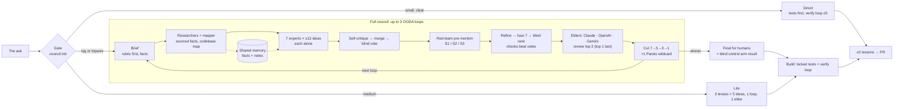

# Council Loop

A research-backed, looped engineering process for AI agents, packaged as an Agent Skill, a Claude
Code plugin, an MCP server and an `AGENTS.md` for every other tool. One program, `council`, keeps
the books: a single Rust binary (command line, MCP server and test-lock hook), with a Python
reference that takes the same commands and is held to the same output by tests.

**ELI5:** For big decisions, your AI acts like a fair team of 7 different experts:
0. First, researchers fetch facts and a mapper draws a map of the code. Everyone shares one notebook.
1. Everyone dreams up ideas alone.
2. A referee hides names and counts votes.
3. A "bad guy" attacks the favourites.
4. Three wise elders from different AI labs check the finalists.
5. Keep the best (7 → 5 → 3 → 1).
6. Build the winner with tests that can't be fudged.
7. Write down what you learned.

Small jobs skip the council and go straight to a test-checked build.



## How you run it

The AI in the chair does the thinking. A program does the bookkeeping, so a run survives a context
reset and nobody counts votes by hand. Two commands, in a loop:

```bash
council doctor                           # once: what can this machine call, which mode fits
council init "<the ask, verbatim>" --stakes medium --reversible yes
#  GATE tier=lite mode=fanout:claude profile=balanced loops<=1 calls~12 tokens~1.8M rel_cost=1.86 (chair: stakes=medium)
#  MEMBERS researchers=2 (papers and primary research; practice in the field; about 10 searches each) mapper=yes (no map yet at docs/ARCHITECTURE.md) memory=files:.council/memory
council next                             # says exactly what to do now; writes each seat's prompt file
council ingest                           # checks what came back; moves on only when it is valid
#  ...next / ingest until the step is `cut`...
council cut --eli5 "<one line: what happened this loop>"
council status                           # after a context reset: where am I, what is still owed
```

`council` is the binary: `cargo install --path .` in a checkout (see [Install](#install)). Without
it, write `sh skills/council-loop/scripts/council` instead: that launcher runs the binary when it
finds one and the Python reference when it does not. Same commands, same output.

`next` prints one of three things: SPAWN lines (start these fresh agents, each with a one-line
prompt), `RUN council dispatch` (seats behind another lab's CLI), or a file for the chair to
edit at one of its five judgment points: the brief, the merge, the fuse, the cut, and the final.

Recommended practice, every setting and **ten worked examples** (an irreversible decision, picking
a vendor, a bug hunt, a small change, refreshing the map, building up research, Obsidian, private
code, an unattended run, a tight budget): [`reference/how-to.md`](skills/council-loop/reference/how-to.md).

## One program, two implementations (new in 0.4)

The bookkeeping exists twice, on purpose.

| | Rust binary `council` | Python reference |
| --- | --- | --- |
| Lives in | `src/` | `skills/council-loop/scripts/`, `mcp/server.py`, `hooks/` |
| Needs at run time | Nothing. Templates, references and model data are compiled in | Python 3.10+ and PyYAML; `mcp[cli]` for the MCP server |
| Command line | `council <verb>` | `python3 skills/council-loop/scripts/council.py <verb>` |
| MCP server | `council mcp` | `mcp/server.py` |
| Test-lock hook | `council hook` | `hooks/protect_locked_files.py` |
| Start-up, measured on one Linux machine (median of 20) | 2 ms for `--version`, 18 ms for `plan` | 50 ms and 187 ms |

Use the binary: it needs nothing installed, and it starts fast enough to sit in a hook that runs
before every edit. The Python reference stays for three reasons. It is the specification the binary
was ported from. It runs where there is no binary (the launcher falls back to it). And two
implementations that must agree catch each other's mistakes: the port found a dozen places where
malformed input made the Python code crash, and both now answer them with a plain message.

**How they are kept the same.** `tests/test_parity.py` plays 16 scenarios (475 commands: whole Lite
and Full runs, a run with broken seat output, a run through fake vendor CLIs, the memory, the map,
the model refresh, paths typed the Windows way) through each implementation, in fresh folders with
the clock frozen. Then it compares every line printed, every exit code and every file written, byte
for byte (JSON by value).
A third play sends each command to the other implementation than the one before it, inside one
project, so a run started by either can be finished by the other at any step. `tests/test_surfaces.py`
does the same for the two MCP servers, through a real MCP client, and for the two hooks. A change of
behaviour is a change to both, or the tests fail.

Where they still differ (the wording of usage errors, a few crash cases, the optional richer code
readers), and what is not proven yet: [`docs/PORTING.md`](docs/PORTING.md).

## Researchers, a mapper and a shared memory (new in 0.3)

| Member | What it does | Set it with |
| --- | --- | --- |
| **Researchers** (2 by default, 0 to 4) | Work before the first ideation, each on its own beat: papers, practice in the field, the case against, the project's own record. Bring back facts, each with a source and an exact quote | `--research N`, `--no-research`, `--research-budget N`, `--research-later …` |
| **Mapper** | Keeps `docs/ARCHITECTURE.md` current: purpose and philosophy, a diagram, code map, interfaces, invariants, how to extend it. Runs only when the code's structure changed. A script ranks the code first; the tool checks every path the map names | `--map stale\|always\|never`, `--no-map`, `--focus-tokens N` |
| **Shared memory** | One note per fact, kept across runs, plus a page per run of what members said to each other. Plain Markdown in the project, or in your Obsidian vault with a table view | `council memory setup --obsidian --vault "<path>"`, `--obsidian` |

The rule that keeps the council honest: **facts reach every seat at once; thoughts arrive one step
later, unsigned, and never inside a blind vote.** Seats never write the memory themselves; one script
files what they report. Everything is a setting, by flag, by `.council/config.yaml` or by your own
`~/.council/config.yaml`; `council config` shows each value and who set it. Details:
[`reference/members-and-memory.md`](skills/council-loop/reference/members-and-memory.md).

Built on the best open work, with credit: the code ranking is the method of
[aider's repo map](https://github.com/Aider-AI/aider/blob/main/aider/repomap.py); the researchers follow
the practice of Anthropic's research prompts, Open Deep Research, GPT Researcher and STORM; the notes
follow Obsidian's formats and Basic Memory's knowledge format. No code was copied. What was taken
from each project, and under which licence: [`reference/prior-art.md`](skills/council-loop/reference/prior-art.md).

## Install

| You use | Do this |
| --- | --- |
| **The binary** (every tool below can use it) | In a checkout: `cargo install --path .` puts `council` on your PATH. Or `cargo build --release`: the launcher finds `target/release/council` by itself. No prebuilt binaries are published yet; `.github/workflows/release.yml` builds them when a version tag is pushed |
| **Claude Code (plugin)** | `/plugin marketplace add <your-org>/council-loop`, then `/plugin install council-loop@sylvan-labs`. This installs the skill, 5 subagents, the locked-files hook and the MCP server. The hook starts through `bin/council`: the binary if you installed it, the Python reference if not. The MCP server is `council mcp`, so it needs the binary on your PATH |
| **Claude Code (skill only)** | Copy `skills/council-loop/` to `.claude/skills/` (one project) or `~/.claude/skills/` (all projects), then add `docs/CLAUDE.md-snippet.md` to your CLAUDE.md |
| **Any MCP client** (Claude Desktop, Cursor, Codex, Gemini CLI…) | Add a server with the command `council mcp` (stdio). Without the binary: `uv run --with "mcp[cli]" --with pyyaml python /path/to/council-loop/mcp/server.py` |
| **Codex / Gemini CLI / Cursor without MCP** | Copy `AGENTS.md` and `skills/` into your repo. Gemini CLI: set `contextFileName` to `AGENTS.md` |
| **claude.ai / Cowork** | Upload `skills/council-loop/` as a skill. Without a shell, do the script's steps by hand (the skill explains how) |

Requirements: either the `council` binary, or Python 3.10+ with `pyyaml` (and `mcp[cli]` for the
Python MCP server). To build the binary: Rust 1.85 or newer and a C compiler (the reader for Python
code, tree-sitter, is C). Optional: the `claude`, `codex` and `gemini` CLIs or an `OPENROUTER_API_KEY`
for cross-lab seats, an `AA_API_KEY` (free) to refresh model picks, and, for the Python reference
only, `tree-sitter-language-pack` for richer code maps in languages other than Python.

### Windows

Both implementations were built for Windows and put through the test suite as Windows programs
under Wine: 143 tests pass, and the 3 skipped need git, a POSIX shell or an optional parser pack.
Neither has run on a real Windows machine yet: CI does that on the first push. What to know:

- **The binary.** `cargo install --path .` puts `council.exe` on your PATH. From cmd or PowerShell,
  `bin\council.cmd` also works: it finds the binary, or falls back to `python`.
- **The plugin's hook** runs in Git Bash, which is where Claude Code runs hooks on Windows
  ([hooks reference](https://code.claude.com/docs/en/hooks)). Without Git for Windows the hook does
  nothing. It is written so that it can never fail, because there a failing hook can block every tool
  call. To keep the lock without Git Bash, add a hook of your own that needs no shell, in
  `.claude/settings.json`:

  ```json
  {"hooks": {"PreToolUse": [{"matcher": "Edit|Write|MultiEdit|NotebookEdit|Bash",
    "hooks": [{"type": "command", "command": "council", "args": ["hook"]}]}]}}
  ```

  CI (`council verify-locks`) guards the locked files either way.
- **The plugin's MCP server** is `council mcp`, so it needs `council.exe` on your PATH.
- **Text.** Files and output are UTF-8 with `\n` line ends on every system. Files written by Windows
  tools (CRLF, a byte-order mark, UTF-16 from PowerShell's `>`) are read without complaint.
- **Python fallback.** The launcher looks for `python3`, then `python`, then `py`, and passes over
  the Microsoft Store's placeholder. Set `COUNCIL_PYTHON` to name an interpreter yourself.

## Commands and interfaces

| Where | Command | What it does |
| --- | --- | --- |
| Chat | `/council-loop <task>` or say "council" | Runs the skill: shows the GATE line, then the tier's steps |
| Chat phrases | "full council" · "lite" · "direct" · "solo" · "max" · "efficient" · "4 loops" · "dry run" | Override tier, mode, profile or loop cap |
| Run loop | `council init "<ask>"` | Starts a run: gate, seats, files. Prints the GATE line |
| Run loop | `council next` | Prepares the current step and says exactly what to do. Safe to repeat |
| Run loop | `council ingest` | Validates what came back. `--drop L3 --reason "…"` goes on without a named seat |
| Run loop | `council dispatch` | Runs seats that live behind the claude, codex or gemini CLI, or OpenRouter |
| Run loop | `council cut --eli5 "…"` | Ends a loop. `--asked "Q -> A"` or `--unattended "…"` at a judgment point; `--stop "…"` to finish early |
| Run loop | `council status` | One-screen digest and what is still owed |
| Members | `--research N` · `--no-research` · `--research-budget N` · `--research-later on_request\|always\|never` · `--map stale\|always\|never` · `--no-map` · `--focus-tokens N` · `--obsidian` (on `init` and `plan`) | How many researchers, how far they search, when the mapper runs, where the memory lives |
| Members | `council config [--example]` | Every setting and who set it · a commented example file |
| Memory | `council note "<text>" [--to all\|chair\|research]` | Post to the run's commons, or put a question to the researchers |
| Memory | `council memory status` · `search "<words>"` · `add --claim … --source …` · `retire <note> --because …` · `import --from <dir>` · `setup --obsidian --vault <path>` | The research notes: find, add, retire (never delete), move into a vault |
| Map | `council map` · `--check` · `--packet` · `--install FILE` · `--validate` · `--accept` · `--focus "<task>"` · `--parsers` | Skeleton and staleness · CI check · refresh without a council · the code that matters for one task |
| Record | `council deviation "<what and why>"` | Logs anything done outside the protocol |
| Record | `council audit` | Re-counts every vote from the ballots on disk; exit 1 on a mismatch |
| Planning | `council plan "<ask>"` · `council doctor [--probe]` | Free dry run of the gate · what this machine can reach |
| Models | `council models --mode fanout:claude --profile efficient` · `council refresh` | Picks per role · rebuild from Artificial Analysis |
| Locks | `council lock-tests tests/` · `council verify-locks --against origin/main` | Lock the answer key; CI fails if it changed |
| Blocks | `council blind` · `tally` · `check` · `ask` · `elders` | The same pieces, usable on their own |
| Surfaces | `council mcp` · `council hook` | The MCP server on standard input and output · the Claude Code hook that blocks edits to locked files. The binary serves both itself; without it the launcher starts `mcp/server.py` and `hooks/protect_locked_files.py` |
| MCP tools | `council_init` · `council_next` · `council_ingest` · `council_dispatch` · `council_cut` · `council_status` · `council_note` · `council_deviation` · `council_audit` · `council_config` · `council_memory_search` · `council_memory_add` · `council_memory_status` · `council_memory_setup` · `council_map` · `council_doctor` · `council_plan` · `council_models` · `council_blind` · `council_tally` · `council_check_run` · `council_verify_locks` · `council_elder_review` | The same verbs for any MCP client. Run-loop tools take `project_dir` |
| MCP resources | `skill://council-loop/SKILL.md` · `council://reference/{name}` · `council://templates/{name}` · `council://models/lock` | The instructions, the seat packets and the current picks |
| MCP prompt | `council_loop(task, tier, mode, profile)` | Slash-command entry point |

`council` is the binary, or the launcher `skills/council-loop/scripts/council` (in a checkout or a
plugin folder also `bin/council`), which runs the binary when there is one and the Python reference
when there is not.

## What it costs

Measured on one host, in one real run. Your host will differ.

| Tier | Council calls | Tokens | With 2 researchers and the mapper | Use it for |
| --- | ---: | ---: | --- | --- |
| Direct | 1 | one agent's work | none | Small, clear, reversible changes |
| Lite | 9 | about 1.3M (measured: 1,269,206) | 12 calls, about 1.8M | Medium decisions |
| Full, 3 loops | 76 | about 7M to 9M (estimated from the Lite run's per-call figures) | 79 calls, about 7.8M | Decisions that are expensive to get wrong |

The researcher and mapper figures are assumptions (200k and 150k tokens a call), not measurements:
no real run has seated them yet. The mapper is counted only when the map is missing or behind the code.

A blind vote cost about 64,000 tokens for a 2,000-token packet: the agent's start-up overhead is
most of the bill. `init` prints the estimate before any tokens are spent, and the numbers behind it
are in `models/policy.yaml`.

## Proof it runs

The kit was used on itself: a Lite council of nine agents reviewed this repo through the commands
above. It found thirteen real faults, most of them reproduced by agents that ran the code, and the
worst was in the vote counter. All are fixed and each has a regression test. The hidden one-shot
baseline found the worst fault alone for 12% of the tokens; the council found it and twelve more.
The honest write-up, with costs and the three places the run left its own protocol, is
[`docs/council-run-2026-11-13-self-review.md`](docs/council-run-2026-11-13-self-review.md), and every
packet, ballot and review is in [`docs/runs/`](docs/runs/261113-183103-take-turn-review/).

## Model modes × profiles

Three modes:
- **`solo`**: the current model plays every role.
- **`fanout:<claude|gemini|openai|openrouter|open|mix>`**: a strong chair plus cheaper workhorses.
- **`crosslab`**: one elder per lab.

Each mode comes in three profiles: `max`, `balanced` and `efficient`. Every pick uses one rule:
`score = AA Intelligence Index − k × log2(AA cost per task)`. Picks are regenerated from
[Artificial Analysis](https://artificialanalysis.ai) data into `models/lock.yaml`, so new models
slot in without code changes.

Balanced profile as of 2026-11-13:

| Mode | Chair | Experts (7 seats) | Elders |
| --- | --- | --- | --- |
| crosslab | Claude Fable 5.2 (high) | 5× GPT-6.1 Sol (high) + Fable 5.2 (low) + Gemini 4 Argon | Fable 5.2 · GPT-6.1 Sol (max) · Gemini 4 Argon |
| fanout:claude | Claude Fable 5.2 (high) | 5× Fable 5.2 (low) + Opus 5.5 (high) + Sonnet 5.5 (xhigh) | Fable 5.2 · Opus 5.5 · Sonnet 5.5 |
| fanout:openai | GPT-6.1 Sol (max) | 5× GPT-6.1 Sol (medium) + Terra (high) + GPT-6 Astra (high) | Sol · Astra · Terra |
| fanout:open | Kimi K3.1 Pro | 7× Kimi K3.1 Pro | Kimi K3.1 Pro (fresh contexts) |

A seat whose model cannot be reached from your machine is played by the chair's model in a fresh
context and labelled a **stand-in** everywhere. Full tables, the routing rules and how to extend
them: [`reference/model-modes.md`](skills/council-loop/reference/model-modes.md).

## Why it works (short version)

Every rule maps to a published result. The full table is in
[`reference/research.md`](skills/council-loop/reference/research.md). The essentials:
- Loops help only with real feedback ([Self-Refine](https://arxiv.org/abs/2303.17651v2),
  [DeepMind on self-correction](https://arxiv.org/html/2310.01798v2)).
- Independent ideas beat groupthink ([Diehl & Stroebe](https://www.uni-muenster.de/imperia/md/content/psyifp/aeechterhoff/wintersemester2011-12/seminarthemenfelderdersozialpsychologie/08_diehl_stoebe_productivityloss-brainstorming_jpsp1987.pdf),
  [Wynn et al.](https://arxiv.org/html/2509.05396v2)).
- Judges are biased, so votes are blind and every voter reads a different order ([MT-Bench](https://arxiv.org/abs/2306.05685)).
- Diverse strong juries beat one judge ([PoLL](https://arxiv.org/html/2404.18796v2)).
- Keep diversity while narrowing ([GEPA](https://arxiv.org/html/2507.19457v1)).
- Size effort to the task ([Anthropic](https://www.anthropic.com/engineering/multi-agent-research-system)).
- Compress the conversation, never the evidence ([Anthropic](https://www.anthropic.com/engineering/effective-context-engineering-for-ai-agents),
  [ACE](https://arxiv.org/html/2510.04618v1)).

Sizing, context, chunking and memory rules:
[`reference/context-and-memory.md`](skills/council-loop/reference/context-and-memory.md).

## Safety rails

- One writer builds. Seats write only their own output file. In the plugin's agent definitions the
  experts have no shell; the red team and the elders may run code, in a scratch copy, to reproduce a claim.
- Agents get no production or publishing credentials.
- Tests are locked: a hook blocks edits, and CI (`verify-locks --against origin/<base>`) enforces
  the lock for every tool, reading the manifest from the base branch.
- Votes are counted by the script, never by the chair. Authors come from provenance, not typing.
  A vote may not cut a card it could not judge. `audit` re-counts a finished run.
- The loop never edits its own rubric or tests. Lessons and model changes arrive as PRs.
- Cross-vendor modes send prompts to other companies. Use `solo` or a single-family mode for code
  that must not leave one vendor.

## Known limits

- The researchers, the mapper and the shared memory are tested with scripted seats only (no model in
  the loop). Their real cost, and how good their facts and maps are, is not measured yet.
- No real model has run through the Rust binary. The one real council so far (the Lite run above)
  ran on the Python reference of version 0.2. What is proven for the binary is that it prints and
  writes what the reference does, in every tested scenario.
- Two implementations must be changed together. The parity tests enforce that; they are skipped, not
  passed, when no binary is built.
- Researchers behind the codex or gemini CLI search the web only if those tools are set up to; a seat
  behind a bare API cannot. Facts that were only recalled are stored as such.
- The Obsidian `Research.base` table follows the documented syntax and parses, but was not opened in
  Obsidian from here.
- Developed on Linux. Windows builds of both implementations pass the test suite under Wine, which
  is not Windows; nothing has run on a real Windows or macOS machine. The launcher under Git Bash and
  the release workflow have never run. CI runs both systems; until its first green run, treat a
  failure there as a finding.
- The codex and gemini adapters are written from those tools' documentation and tested against a
  fake CLI only. Run `council doctor --probe` and one Lite council before relying on them.
- Blinding guards against bias, not against an agent that sets out to cheat. `audit` detects edits
  made after an output was accepted, not before.
- The Full-tier token figure is an estimate. No Full run has been measured yet.
- Whether a council beats one strong model on your work is an open question the control arm is
  there to answer. In the one run so far it did, at 8 times the cost.

## Rollout

| Stage | When | Ships | Go / no-go |
| --- | --- | --- | --- |
| 1 | Weeks 1–2 | Gate, Direct, Lite, model registry | Blind A/B on ≥20 real tasks vs the current workflow |
| 2 | Weeks 3–4 | Full council, with cross-lab seats checked by `doctor --probe` | Council output preferred ≥65% at ≤3x cost |
| 3 | Month 2 | Golden set, outcome ledger, monthly fire drill | Win rate holds; gates fire in drills |

## Repo layout

```text
Cargo.toml · build.rs  the Rust crate `council-loop`: one binary, `council`
src/                   the binary
  cli.rs                 every verb and flag
  core.rs · gate.rs      settings, blind, count, cut, locks · doctor and plan
  run/                   the resumable run loop: init, next, ingest, cut, dispatch, status, audit, note
  memory.rs              the shared memory: research notes, commons, Obsidian
  codemap.rs · pyread.rs skeleton and ranking of a codebase, staleness, checks on the written map
  providers.rs           claude, codex, gemini and OpenRouter adapters
  refresh.rs             model picks from Artificial Analysis data
  mcp.rs · hook.rs       the MCP server · the locked-files hook
  py.rs · yaml.rs · …    behave as the Python reference does: formatting, shuffle, YAML, templates
bin/                   council, council.cmd: launchers for a checkout or a plugin folder
skills/council-loop/   SKILL.md · reference/ · templates/packets/ · scripts/ · models/
  scripts/council        the launcher: the binary when there is one, otherwise the Python reference
  scripts/*.py           the Python reference: council, run, memory, codemap, providers, refresh_models
agents/                council-expert, council-red-team, council-elder, council-researcher, council-mapper
hooks/                 hooks.json (calls `council hook`) and the Python reference of the hook
mcp/server.py          the Python reference of the MCP server
docs/                  ARCHITECTURE.md (this repo's own map), PORTING.md (how the two are kept the same), CLAUDE.md snippet, lessons, outcomes, council run records
.council/              config.yaml (optional), memory/ (38 sourced facts behind this kit), map/state.json
tests/                 pytest: the reference alone, then both implementations side by side (test_parity.py, test_surfaces.py)
.github/workflows/     ci.yml (both implementations, three systems) · release.yml (binaries on a version tag)
```

## Development

```bash
cargo build --release                       # the binary: target/release/council
cargo test                                  # 42 unit tests
cargo clippy --all-targets -- -D warnings
pip install pyyaml pytest "mcp[cli]"
pytest -q                                   # 146 tests: the reference alone, then both implementations side by side
council map --check                         # the map in docs/ARCHITECTURE.md matches the code
claude plugin validate .                    # plugin manifest check
council refresh --offline skills/council-loop/models/snapshot-2026-11-13.json --table balanced
```

Change behaviour in both implementations, then run `pytest tests/test_parity.py`: it says where they
stopped agreeing. Without a built binary the parity tests are skipped, not passed.

MIT License. Model data © [Artificial Analysis](https://artificialanalysis.ai), used with attribution
as required by their API terms.
