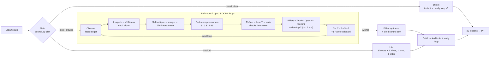

# Council Loop

A research-backed, looped engineering process for AI agents, packaged as an Agent Skill, a Claude
Code plugin, an MCP server and an `AGENTS.md` for every other tool.

**ELI5:** For big decisions, your AI acts like a fair team of 7 different experts:
1. Everyone dreams up ideas alone.
2. A referee hides names and counts votes.
3. A "bad guy" attacks the favourites.
4. Three wise elders from different AI labs check the finalists.
5. Keep the best (7 → 5 → 3 → 1).
6. Build the winner with tests that can't be fudged.
7. Write down what you learned.

Small jobs skip the council and go straight to a test-checked build.



## Install

| You use | Do this |
| --- | --- |
| **Claude Code (plugin)** | `/plugin marketplace add <your-org>/council-loop`, then `/plugin install council-loop@sylvan-labs`. This installs the skill, 3 read-only subagents, the locked-files hook and the MCP server |
| **Claude Code (skill only)** | Copy `skills/council-loop/` to `.claude/skills/` (one project) or `~/.claude/skills/` (all projects), then add `docs/CLAUDE.md-snippet.md` to your CLAUDE.md |
| **Any MCP client** (Claude Desktop, Cursor, Codex, Gemini CLI…) | Add a server: `uv run --with "mcp[cli]" --with pyyaml python /path/to/council-loop/mcp/server.py` (stdio) |
| **Codex / Gemini CLI / Cursor without MCP** | Copy `AGENTS.md` and `skills/` into your repo. Gemini CLI: set `contextFileName` to `AGENTS.md` |
| **claude.ai / Cowork** | Upload `skills/council-loop/` as a skill. Do the script steps by hand (the skill explains how) |

Requirements: Python 3.10+, `pyyaml`; `mcp[cli]` for the server. Optional: the `claude`, `codex` and
`gemini` CLIs or an `OPENROUTER_API_KEY` for cross-lab seats, and an `AA_API_KEY` (free) to refresh
model picks.

## Commands and interfaces

| Where | Command | What it does |
| --- | --- | --- |
| Chat | `/council-loop <task>` or say "council" | Runs the skill: prints the GATE line, then the tier's steps |
| Chat phrases | "full council" · "lite" · "direct" · "solo" · "max" · "efficient" · "4 loops" · "skip elders" · "dry run" | Override tier, mode, profile or loop cap |
| CLI | `council.py plan "<task>" --mode crosslab --profile balanced` | Dry-run gate: tier, models, cost, checks (no tokens) |
| CLI | `council.py models --mode fanout:claude --profile efficient` | Model picks per role |
| CLI | `council.py blind cards.json --seed 7 --out packet.md` | Hide authors, shuffle, enforce word caps |
| CLI | `council.py tally votes.json packet.md.mapping.json --keep 5 --scores s.json --checks c.json` | Borda, self-votes excluded, checks beat votes, cut + wildcard |
| CLI | `council.py elders --packet packet.md --profile balanced` | Cross-lab elder review in parallel (`--dry-run` to preview) |
| CLI | `council.py ask --provider openai --prompt-file p.md` | One seat on another model family |
| CLI | `council.py check .council/runs/<id>/run.json` | Did the run follow the protocol? |
| CLI | `council.py lock-tests tests/` · `council.py verify-locks` | Lock the answer key; CI fails if it changed |
| CLI | `refresh_models.py` · `refresh_models.py --check` | Rebuild model picks from Artificial Analysis; staleness check |
| MCP tools | `council_plan` · `council_models` · `council_blind` · `council_tally` · `council_check_run` · `council_verify_locks` · `council_elder_review` | Same functions, for any MCP client |
| MCP resources | `skill://council-loop/SKILL.md` · `council://reference/{name}` · `council://templates/{name}` · `council://models/lock` | The instructions and current picks |
| MCP prompt | `council_loop(task, tier, mode, profile)` | Slash-command entry point |

CLI paths are relative to `skills/council-loop/scripts/`.

## Model modes × profiles

Three modes:
- **`solo`**: the current model plays every role.
- **`fanout:<claude|gemini|openai|openrouter|open|mix>`**: a strong chair plus cheaper workhorses.
- **`crosslab`**: one elder per lab.

Each mode comes in three profiles: `max`, `balanced` and `efficient`. Every pick uses one rule:
`score = AA Intelligence Index − k × log2(AA cost per task)`. Picks are regenerated from
[Artificial Analysis](https://artificialanalysis.ai) data into `models/lock.yaml`, so new models
slot in without code changes.

Balanced profile as of 2026-11-13:

| Mode | Chair | Experts (7 seats) | Elders |
| --- | --- | --- | --- |
| crosslab | Claude Fable 5.2 (high) | 5× GPT-6.1 Sol (high) + Fable 5.2 (low) + Gemini 4 Argon | Fable 5.2 · GPT-6.1 Sol (max) · Gemini 4 Argon |
| fanout:claude | Claude Fable 5.2 (high) | 5× Fable 5.2 (low) + Opus 5.5 (high) + Sonnet 5.5 (xhigh) | Fable 5.2 · Opus 5.5 · Sonnet 5.5 |
| fanout:openai | GPT-6.1 Sol (max) | 5× GPT-6.1 Sol (medium) + Terra (high) + GPT-6 Astra (high) | Sol · Astra · Terra |
| fanout:open | Kimi K3.1 Pro | 7× Kimi K3.1 Pro | Kimi K3.1 Pro (fresh contexts) |

Full tables, rules and how to extend them: [`reference/model-modes.md`](skills/council-loop/reference/model-modes.md).

## Why it works (short version)

Every rule maps to a published result. The full table is in
[`reference/research.md`](skills/council-loop/reference/research.md). The essentials:
- Loops help only with real feedback ([Self-Refine](https://arxiv.org/abs/2303.17651v2),
  [DeepMind on self-correction](https://arxiv.org/html/2310.01798v2)).
- Independent ideas beat groupthink ([Diehl & Stroebe](https://www.uni-muenster.de/imperia/md/content/psyifp/aeechterhoff/wintersemester2011-12/seminarthemenfelderdersozialpsychologie/08_diehl_stoebe_productivityloss-brainstorming_jpsp1987.pdf),
  [Wynn et al.](https://arxiv.org/html/2509.05396v2)).
- Judges are biased, so votes are blind ([MT-Bench](https://arxiv.org/abs/2306.05685)).
- Diverse strong juries beat one judge ([PoLL](https://arxiv.org/html/2404.18796v2)).
- Keep diversity while narrowing ([GEPA](https://arxiv.org/html/2507.19457v1)).
- Size effort to the task ([Anthropic](https://www.anthropic.com/engineering/multi-agent-research-system)).
- Compress the conversation, never the evidence ([Anthropic](https://www.anthropic.com/engineering/effective-context-engineering-for-ai-agents),
  [ACE](https://arxiv.org/html/2510.04618v1)).

Sizing, context, chunking and memory rules:
[`reference/context-and-memory.md`](skills/council-loop/reference/context-and-memory.md).

## Safety rails

- Experts, red team and elders are read-only. One writer builds.
- Agents get no production or publishing credentials.
- Tests are locked: a hook blocks edits, and CI (`verify-locks`) enforces the lock for every tool.
- The loop never edits its own rubric or tests. Lessons and model changes arrive as PRs.
- Cross-vendor modes send prompts to other companies. Use `solo` or a single-family mode for code
  that must not leave one vendor.

## Rollout

| Stage | When | Ships | Go / no-go |
| --- | --- | --- | --- |
| 1 | Weeks 1–2 | Gate, Direct, Lite, model registry | Blind A/B on ≥20 real tasks vs the current workflow |
| 2 | Weeks 3–4 | Full council + `council.py` bookkeeping | Council output preferred ≥65% at ≤3x cost |
| 3 | Month 2 | Control arm, golden set, outcome ledger, monthly fire drill | Win rate holds; gates fire in drills |

## Repo layout

```text
.claude-plugin/        plugin.json, marketplace.json, icon
skills/council-loop/   SKILL.md · reference/ · templates/ · scripts/ · models/
agents/                council-expert, council-red-team, council-elder (read-only)
hooks/                 locked-files PreToolUse hook
mcp/server.py          MCP server (thin wrapper over scripts/council.py)
docs/                  CLAUDE.md snippet, lessons, outcomes, the council run that produced v2
tests/                 pytest: CLI, model refresh, hook, MCP server
```

## Development

```bash
pip install pyyaml pytest "mcp[cli]"
pytest -q                                   # 14 tests
claude plugin validate .                    # plugin manifest check
python3 skills/council-loop/scripts/refresh_models.py --offline skills/council-loop/models/snapshot-2026-11-13.json --table balanced
```

MIT License. Model data © [Artificial Analysis](https://artificialanalysis.ai), used with attribution
as required by their API terms.
