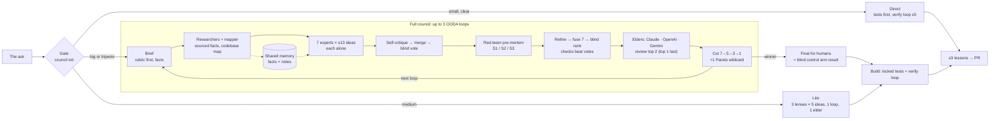

# Council Loop

A research-backed, looped decision process for AI agents, and the small program that referees it.
`council` is one binary: the command line, an API, an MCP server and a Claude Code hook. It is also
packaged as an Agent Skill, a Claude Code plugin and an `AGENTS.md` for every other tool.

**ELI5:** For big decisions, your AI acts like a fair team of 7 different experts:
0. First, researchers fetch facts and a mapper draws a map of the code. Everyone shares one notebook.
1. Everyone dreams up ideas alone.
2. A referee hides names and counts votes.
3. A "bad guy" attacks the favourites.
4. Three wise elders from different AI labs check the finalists.
5. Keep the best (7 → 5 → 3 → 1).
6. Build the winner with tests that can't be fudged.
7. Write down what you learned.

Small jobs skip the council and go straight to a test-checked build.



## See it in one minute

```bash
cargo install --path .        # in a checkout: puts `council` on your PATH (Rust 1.85 or newer, and a C compiler)
council demo                  # a whole council on a made-up question, every seat played by a script
```

`council demo` runs the real commands in a throwaway folder: 12 of them, in about a tenth of a
second. No model is called, nothing is spent and nothing leaves your machine. It ends with the
decision, an audit of the votes, and a list of what a run leaves behind. `council demo --keep`
keeps the folder so you can look around; `council demo --full` plays three loops with seven experts.

The first command you run on a machine also prints a five-line check (what can start seats, which
labs are in reach, how old the model data is) and the mode a run would take. It costs about three
milliseconds and happens once.

## Run a real council

The AI in the chair does the thinking. The program does the bookkeeping, so a run survives a
context reset and nobody counts votes by hand. Two commands, in a loop:

```bash
council init "<the ask, verbatim>" --stakes medium --reversible yes
#  GATE tier=lite mode=fanout:claude profile=efficient loops<=1 calls~12 tokens~1.8M rel_cost=0.66 (chair: stakes=medium)
#  MEMBERS researchers=2 (papers and primary research; practice in the field; about 10 searches each) mapper=yes (no map yet at docs/ARCHITECTURE.md) memory=files:.council/memory
council next                             # says exactly what to do now; writes each seat's prompt file
council ingest                           # checks what came back; moves on only when it is valid
#  ...next / ingest until the step is `cut`...
council cut --eli5 "<one line: what happened this loop>"
council status                           # after a context reset: where am I, what is still owed
```

`next` prints one of three things: SPAWN lines (start these fresh agents, each with a one-line
prompt), `RUN council dispatch` (seats behind another lab's command-line tool), or a file for the
chair to edit at one of its five judgment points: the brief, the merge, the fuse, the cut and the
final.

**A run starts cheap.** With no word from you it takes the cheapest mode your machine can reach and
the `efficient` profile, and the GATE line shows the relative cost before a token is spent. More
rigour is one flag away: `--profile balanced` or `max`, `--mode crosslab` for elders from three
labs. Keep a choice for every run with `defaults:` in your own `~/.council/config.yaml`.

Step by step, with real output: the [tutorials](docs/tutorials/). Recommended practice, every
setting and ten worked examples: [`reference/how-to.md`](skills/council-loop/reference/how-to.md).

## One program, three doors

Behind every door are the same 27 operations, so the rules hold whichever one you use.

| Door | How | Who uses it |
| --- | --- | --- |
| Command line | `council <verb>` | People, and agents that have a shell |
| API | `council api <operation> --args '{...}'`: JSON in, one JSON object out | Scripts, other programs, agents without MCP |
| MCP server | `council mcp`: the operations as tools, the documents as resources, two prompts | Claude Code, Claude Desktop, Cursor, Codex, Gemini CLI and other MCP clients |
| Hook | `council hook` | Claude Code: guards locked tests, keeps council seats in their lane |

```bash
council api --list                                         # the operations, by group
council api plan --args '{"task": "Pick the queue for billing"}'
council mcp --project "$PWD" --read-only                   # a server for one project that changes nothing
```

Every API answer is one envelope: `{ok, code, output, data, run}`. `output` is what the command
line prints (for the run loop: the exact next step) and `run` says where the run stands and which
seats are still owed, so a program can drive a whole council from the answers alone. The server is
configurable by flag, by environment or in your own settings: one project only, read-only, no
sending to model vendors, which groups of tools to offer. Everything: [`reference/commands.md`](skills/council-loop/reference/commands.md).

## Install

| You use | Do this |
| --- | --- |
| **The binary** (everything below needs it) | In a checkout: `cargo install --path .`. Release archives for Linux, macOS and Windows are built by `.github/workflows/release.yml` when a version tag is pushed |
| **Claude Code (plugin)** | `/plugin marketplace add <your-org>/council-loop`, then `/plugin install council-loop@sylvan-labs`. This adds the skill, six subagents, the hook and the MCP server. All of them start `council`, so it must be on your PATH |
| **Claude Code (skill only)** | Copy `skills/council-loop/` to `.claude/skills/` (one project) or `~/.claude/skills/` (all projects), then add [`docs/CLAUDE.md-snippet.md`](docs/CLAUDE.md-snippet.md) to your CLAUDE.md |
| **Any MCP client** (Claude Desktop, Cursor, Codex, Gemini CLI…) | Add a server with the command `council` and the argument `mcp` |
| **Codex, Gemini CLI, Cursor without MCP** | Copy [`AGENTS.md`](AGENTS.md) into your repo. Gemini CLI: add `AGENTS.md` to `context.fileName` in its settings |
| **A script or another agent framework** | Call `council api`. `council api --describe` gives every operation's schema |
| **claude.ai / Cowork** | Upload `skills/council-loop/` as a skill. Without a shell, do the steps by hand (the skill explains how) |

The binary needs nothing at run time: templates, reference pages and model data are compiled in.
Optional: the `claude`, `codex` and `gemini` command-line tools or an `OPENROUTER_API_KEY` for seats
from other labs, and an `AA_API_KEY` (free) to refresh the model picks.

On Windows the hook and the MCP server start `council.exe` directly, with no shell, so it must be on
your PATH. Files and output are UTF-8 with `\n` line ends on every system; files written by Windows
tools (CRLF, a byte-order mark, UTF-16 from PowerShell's `>`) are read without complaint.

## Researchers, a mapper and a shared memory

| Member | What it does | Set it with |
| --- | --- | --- |
| **Researchers** (2 by default, 0 to 4) | Work before the first ideation, each on its own beat: papers, practice in the field, the case against, the project's own record. Bring back facts, each with a source and an exact quote | `--research N`, `--no-research`, `--research-budget N`, `--research-later …` |
| **Mapper** | Keeps `docs/ARCHITECTURE.md` current: purpose and philosophy, a diagram, code map, interfaces, invariants, how to extend it. Runs only when the code's structure changed. A script ranks the code first; the tool checks every path the map names | `--map stale\|always\|never`, `--no-map`, `--focus-tokens N` |
| **Shared memory** | One note per fact, kept across runs, plus a page per run of what members said to each other. Plain Markdown in the project, or in your Obsidian vault with a table view | `council memory setup --obsidian --vault "<path>"`, `--obsidian` |

The rule that keeps the council honest: **facts reach every seat at once; thoughts arrive one step
later, unsigned, and never inside a blind vote.** Seats never write the memory themselves; the
program files what they report. `council config` shows each setting and who set it. Details:
[`reference/members-and-memory.md`](skills/council-loop/reference/members-and-memory.md).

Built on the best open work, with credit: the code ranking is the method of
[aider's repo map](https://github.com/Aider-AI/aider/blob/main/aider/repomap.py); the researchers follow
the practice of Anthropic's research prompts, Open Deep Research, GPT Researcher and STORM; the notes
follow Obsidian's formats and Basic Memory's knowledge format. No code was copied. What was taken
from each project, and under which licence: [`reference/prior-art.md`](skills/council-loop/reference/prior-art.md).

## What it costs

Measured on one host, in one real run. Your host will differ.

| Tier | Council calls | Tokens | With 2 researchers and the mapper | Use it for |
| --- | ---: | ---: | --- | --- |
| Direct | 1 | one agent's work | none | Small, clear, reversible changes |
| Lite | 9 | about 1.3M (measured: 1,269,206) | 12 calls, about 1.8M | Medium decisions |
| Full, 3 loops | 76 | about 7M to 9M (estimated from the Lite run's per-call figures) | 79 calls, about 7.8M | Decisions that are expensive to get wrong |

The researcher and mapper figures are assumptions (200k and 150k tokens a call), not measurements:
no real run has seated them yet. The mapper is counted only when the map is missing or behind the code.

A blind vote cost about 64,000 tokens for a 2,000-token packet: the agent's start-up overhead is
most of the bill. `init` prints the estimate before any tokens are spent, and the numbers behind it
are in `models/policy.yaml`. The program itself is not the cost: it starts in about 2 ms, and a
whole scripted Lite council (12 commands) takes a tenth of a second.

## Model modes × profiles

Three modes:
- **`solo`**: the current model plays every role.
- **`fanout:<claude|gemini|openai|openrouter|open|mix>`**: a strong chair plus cheaper workhorses.
- **`crosslab`**: one elder per lab.

Each mode comes in three profiles: `efficient` (the default), `balanced` and `max`. Every pick uses
one rule: `score = AA Intelligence Index − k × log2(AA cost per task)`. Picks are regenerated from
[Artificial Analysis](https://artificialanalysis.ai) data into `models/lock.yaml`, so new models
slot in without code changes. `council doctor` lists the modes your machine can reach and what
each costs; `council models --mode <mode> --profile <profile>` prints the picks.

A seat whose model cannot be reached from your machine is played by the chair's model in a fresh
context and labelled a **stand-in** everywhere. Full tables, the routing rules and how to extend
them: [`reference/model-modes.md`](skills/council-loop/reference/model-modes.md).

## Safety rails

- One writer builds. Seats write only their own output file. Experts have no shell; the red team
  and the elders may run code, in a scratch copy, to reproduce a claim.
- The seats that read the web do not read your code, and the seats that read your code do not go
  online. Text from outside is treated as evidence, never as an instruction.
- The program writes only inside the project, your own `~/.council` folders and the memory folder
  your own settings name, and never through a symbolic link. A project's settings file cannot move
  the memory out of the project or raise what a run costs.
- Tests are locked: a hook blocks edits, and CI (`verify-locks --against origin/<base>`) enforces
  the lock for every tool, reading the manifest from the base branch.
- Votes are counted by the program, never by the chair. Authors come from provenance, not typing.
  A vote may not cut a card it could not judge. `audit` re-counts a finished run.
- The loop never edits its own rubric or tests. Lessons and model changes arrive as pull requests.
- Cross-vendor modes send prompts to other companies. Use `solo` or a single-family mode for code
  that must not leave one vendor.
- Agents get no production or publishing credentials.

What was attacked, what was fixed and what stays open: [`SECURITY.md`](SECURITY.md).

## How it is tested

`cargo test` runs 117 tests in about a minute (ten seconds with `--release`, once built). No model
is called by any of them.

| Suite | What it proves |
| --- | --- |
| Unit tests (67) | The rules: blinding, the count, the cut, the gate, the YAML writer, the hook's reading of shell lines |
| Scenarios (19) | Whole runs through the real binary. Fifteen are recordings (427 commands: Lite and Full runs, broken seat output, the memory, the map, the model refresh) replayed line for line and file for file; four are played live, with stand-ins for the vendors' tools |
| Security (14) | Every attack of the review, kept as a test: links that lead out of the project, hostile run state and lock manifests, files that never end, patterns built to stall, keys in logs, a fenced server |
| Surfaces (10) | The API from a shell, a whole council through MCP tool calls alone, server options, progress and logging, the hook, the first-run check, the demo |
| Fuzzing (5) | 40,000 damaged inputs with a fixed seed against every reader, every API operation and the server: no crash, no hang, nothing written outside the project |
| Speed (1) | Limits on what must stay fast: start-up, the hook with 1,000 locked files, the gate and the map on 600 files, the server |
| Notices (1) | The licence list in `THIRD-PARTY-NOTICES.md` matches `Cargo.lock` |

How to run them, add a scenario or accept a changed recording: [`docs/testing.md`](docs/testing.md).
Logs, the run diary, measured timings and troubleshooting: [`docs/operations.md`](docs/operations.md).

## Proof it runs

The kit was used on itself: a Lite council of nine agents reviewed this repo through the commands
above. It found thirteen real faults, most of them reproduced by agents that ran the code, and the
worst was in the vote counter. All are fixed and each has a regression test. The hidden one-shot
baseline found the worst fault alone for 12% of the tokens; the council found it and twelve more.
The honest write-up, with costs and the three places the run left its own protocol, is
[`docs/council-run-2026-11-13-self-review.md`](docs/council-run-2026-11-13-self-review.md), and every
packet, ballot and review is in [`docs/runs/`](docs/runs/).

## Why it works (short version)

Every rule maps to a published result. The full table is in
[`reference/research.md`](skills/council-loop/reference/research.md). The essentials:
- Loops help only with real feedback ([Self-Refine](https://arxiv.org/abs/2303.17651v2),
  [DeepMind on self-correction](https://arxiv.org/html/2310.01798v2)).
- Independent ideas beat groupthink ([Diehl & Stroebe](https://www.uni-muenster.de/imperia/md/content/psyifp/aeechterhoff/wintersemester2011-12/seminarthemenfelderdersozialpsychologie/08_diehl_stoebe_productivityloss-brainstorming_jpsp1987.pdf),
  [Wynn et al.](https://arxiv.org/html/2509.05396v2)).
- Judges are biased, so votes are blind and every voter reads a different order ([MT-Bench](https://arxiv.org/abs/2306.05685)).
- Diverse strong juries beat one judge ([PoLL](https://arxiv.org/html/2404.18796v2)).
- Keep diversity while narrowing ([GEPA](https://arxiv.org/html/2507.19457v1)).
- Size effort to the task ([Anthropic](https://www.anthropic.com/engineering/multi-agent-research-system)).
- Compress the conversation, never the evidence ([Anthropic](https://www.anthropic.com/engineering/effective-context-engineering-for-ai-agents),
  [ACE](https://arxiv.org/html/2510.04618v1)).

Sizing, context, chunking and memory rules:
[`reference/context-and-memory.md`](skills/council-loop/reference/context-and-memory.md).

## Documents

| For | Read |
| --- | --- |
| A first look | [Tutorial 1: your first council](docs/tutorials/01-first-council.md) (five minutes, no model) |
| Running one for real | [Tutorial 2: a real council in Claude Code](docs/tutorials/02-a-real-council.md) |
| Other AI tools | [Tutorial 3: Codex, Gemini CLI, Cursor and other agents](docs/tutorials/03-other-ai-tools.md), [`AGENTS.md`](AGENTS.md), [`llms.txt`](llms.txt) |
| Tests nobody can bend | [Tutorial 4: locked tests and CI](docs/tutorials/04-locked-tests-and-ci.md) |
| Keeping what was learned | [Tutorial 5: the shared memory and Obsidian](docs/tutorials/05-shared-memory-and-obsidian.md) |
| Building on it | [Tutorial 6: the API and the MCP server](docs/tutorials/06-build-on-the-api.md) |
| Everyday questions | [`reference/how-to.md`](skills/council-loop/reference/how-to.md): practice, settings, ten examples, what to do when something goes wrong |
| Looking something up | [`reference/commands.md`](skills/council-loop/reference/commands.md), [`reference/protocol.md`](skills/council-loop/reference/protocol.md) |
| Running it day to day | [`docs/operations.md`](docs/operations.md) |
| Changing it | [`CONTRIBUTING.md`](CONTRIBUTING.md), [`docs/testing.md`](docs/testing.md), [`docs/ARCHITECTURE.md`](docs/ARCHITECTURE.md) |
| Trusting it | [`SECURITY.md`](SECURITY.md) |

## Known limits

- The researchers, the mapper and the shared memory are tested with scripted seats only (no model in
  the loop). Their real cost, and how good their facts and maps are, is not measured yet.
- One real council has run so far (the Lite run above), on version 0.2, which was written in Python.
  No real model has run through this binary. What is proven for it is the bookkeeping: the scenarios
  it replays were recorded when it printed and wrote exactly what that earlier implementation did.
- Researchers behind the codex or gemini tools search the web only if those tools are set up to; a
  seat behind a bare API cannot. Facts that were only recalled are stored as such.
- The codex and gemini adapters are written from those tools' documentation and tested against
  stand-ins only. Run `council doctor --probe` and one Lite council before relying on them.
- Developed on Linux. Under Wine, which is not Windows, the Windows build passes 91 of the 117
  tests: the unit tests, the API, server and hook tests, the fuzzing and the live scenarios. Of the
  other 26, 24 need a Unix system (links, file modes, the recorded scenarios), the notices check
  needs `cargo`, and Wine's slow file layer misses one speed limit. Nothing has run on a real
  Windows or macOS machine, and the release workflow has never run. CI runs all three systems;
  until its first green run, treat a failure there as a finding.
- The hook is a seat belt, not a wall: a shell can change a file in ways no hook can foresee. The
  lock that holds is the CI check. More in [`SECURITY.md`](SECURITY.md).
- The Obsidian `Research.base` table follows the documented syntax and parses, but was not opened in
  Obsidian from here.
- Blinding guards against bias, not against an agent that sets out to cheat. `audit` detects edits
  made after an output was accepted, not before.
- The Full-tier token figure is an estimate. No Full run has been measured yet.
- Whether a council beats one strong model on your work is an open question the control arm is
  there to answer. In the one run so far it did, at 8 times the cost.

## Rollout

| Stage | When | Ships | Go / no-go |
| --- | --- | --- | --- |
| 1 | Weeks 1–2 | Gate, Direct, Lite, model registry | Blind A/B on ≥20 real tasks vs the current workflow |
| 2 | Weeks 3–4 | Full council, with cross-lab seats checked by `doctor --probe` | Council output preferred ≥65% at ≤3x cost |
| 3 | Month 2 | Golden set, outcome ledger, monthly fire drill | Win rate holds; gates fire in drills |

## Repo layout

```text
Cargo.toml · build.rs  the Rust crate `council-loop`: one binary, `council`
src/                   the binary
  cli.rs                 every verb and flag
  api.rs                 the API surface: one registry of operations and documents
  mcp.rs · hook.rs       the MCP server, generated from the API · the hook
  core.rs · gate.rs      settings, blind, count, cut, locks · doctor and plan
  run/                   the resumable run loop: init, next, ingest, cut, dispatch, status, audit, log
  memory.rs              the shared memory: research notes, commons, Obsidian
  codemap.rs · pyread.rs skeleton and ranking of a codebase, staleness, checks on the written map
  providers.rs           claude, codex, gemini and OpenRouter adapters
  refresh.rs             model picks from Artificial Analysis data
  safe.rs · log.rs       the one door for writes and risky reads · diagnostics and the run diary
  demo.rs · welcome.rs   the scripted council · the first-run check
skills/council-loop/   SKILL.md · reference/ · templates/packets/ · models/   (compiled into the binary)
agents/                council-expert, -red-team, -elder, -researcher, -historian, -mapper
hooks/hooks.json       wires `council hook` into Claude Code, with no shell
docs/                  tutorials/, operations, testing, ARCHITECTURE.md (this repo's own map), run records
tests/                 scenarios (with cassettes/), security, surfaces, fuzz, speed
.council/              memory/ (the sourced facts behind this kit), map/state.json
.github/workflows/     ci.yml (three systems, and Rust 1.85) · release.yml (binaries on a version tag)
```

## The Python implementation (legacy)

Until 0.4 the kit also shipped a Python implementation that printed the same lines and wrote the
same files. From 0.5 the kit is the binary alone. The Python scripts are frozen as a separate
package that gets security fixes only: [`docs/LEGACY.md`](docs/LEGACY.md).

## Licence

MIT: see [`LICENSE`](LICENSE). The licences of the crates compiled into the binary are listed in
[`THIRD-PARTY-NOTICES.md`](THIRD-PARTY-NOTICES.md). Model data © [Artificial Analysis](https://artificialanalysis.ai),
used with attribution as required by their API terms.
