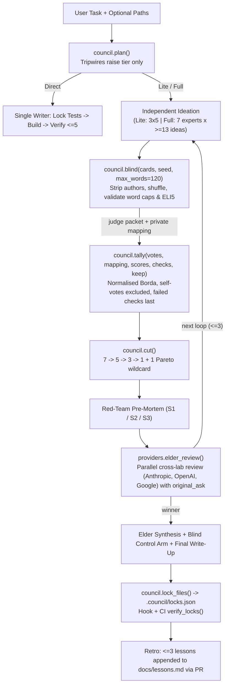

# Council Loop — Architecture & Dataflow

This document describes the standalone dataflow, integration surfaces, state files, and error/fallback contracts of the `council-loop` repository.

## 1. System Overview & Integration Surfaces

All surfaces route through a single enforcement module (`skills/council-loop/scripts/council.py`) so tier gating, blind shuffling, Borda tallying, lock verification, and run-ledger checks behave identically everywhere:

| Surface | Entrypoint | Role |
| --- | --- | --- |
| **Agent Skill** | `skills/council-loop/SKILL.md` | Progressive-disclosure protocol instructions, templates (`skills/council-loop/templates/`), and references (`skills/council-loop/reference/`). |
| **Antigravity Discovery** | `.agents/skills.json` | Registers `skills/` for automatic workspace discovery when `council-loop` is opened in Antigravity. |
| **CLI** | `skills/council-loop/scripts/council.py` | Direct command-line enforcement (`plan`, `models`, `blind`, `tally`, `check`, `lock-tests`, `verify-locks`, `ask`, `elders`, `refresh`). |
| **MCP Server** | `mcp/server.py` (configured via `.mcp.json`) | Exposes `skill://council-loop/SKILL.md`, `council://reference/{name}`, `council://templates/{name}`, `council://models/lock`, prompt `council_loop`, and 7 bookkeeping tools over stdio. |
| **Claude Code Plugin** | `.claude-plugin/plugin.json`, `agents/*.md`, `hooks/hooks.json` | Bundles read-only subagent definitions (`council-expert`, `council-red-team`, `council-elder`) and the `PreToolUse` file-lock hook (`hooks/protect_locked_files.py`). |
| **Cross-Tool Rules** | `AGENTS.md`, `docs/CLAUDE.md-snippet.md` | Portable agent rules for Codex, Gemini CLI, Cursor, and Claude Code. |
| **CI Backstop** | `.github/workflows/ci.yml` | Runs `pytest -q`, model freshness check (`refresh_models.py --check`), and lock verification (`council.py verify-locks`). |

---

## 2. End-to-End Council Loop Dataflow

---

## 3. Model Registry & Routing Dataflow

1. **Inputs**:
   - Selection policy: `skills/council-loop/models/policy.yaml` (modes, `max`/`balanced`/`efficient` profiles, bans, access flags, pins, and `k` cost-quality weights).
   - Benchmark source: Artificial Analysis API (`load_live` using `AA_API_KEY`) or offline snapshot JSON (`skills/council-loop/models/snapshot-*.json` via `--offline`).
2. **Resolution (`refresh_models.py`)**:
   - Filters banned/restricted models, computes `quality - k * log2(cost)`, assigns `chair`, `experts` (7 seats), `red_team`, `elders`, and `verifier` across `solo`, `crosslab`, and `fanout:<family>`, and normalizes `relative_cost` so `balanced/crosslab == 1.0`.
3. **Output (`skills/council-loop/models/lock.yaml`)**:
   - Read by `council.models_for(mode, profile)` and `providers.elder_review(...)`.
   - Checked for staleness against `stale_after_days` via `refresh_models.py --check`.

---

## 4. State Files, Validation & Error / Fallback Contracts

| Artifact / State | Schema & Writer | Enforcement & Fallback Contract |
| --- | --- | --- |
| `.council/locks.json` | JSON map of POSIX-normalised relative file paths -> SHA-256 hex digest, written by `council.lock_files()`. | **Hook**: `hooks/protect_locked_files.py` normalises Windows/POSIX paths and denies `Edit`/`Write`/`MultiEdit`/`NotebookEdit` and mutating `Bash` commands unless `COUNCIL_ALLOW_LOCKED=1`. **CI/MCP**: `council.verify_locks()` exits `1` if any locked file is missing or modified. |
| `.council/runs/<id>/run.json` | Loop ledger validated by `council.check_run()`. | Rejects missing `intent_brief`, `rubric`, `original_ask`, missing ELI5s, `<13` (full) or `<5` (lite) ideas per expert, `>120` word cards, missing red-team entries, or `loops > max_loops`. Emits warnings for missing retros, survivor count mismatches, or `<3` full-tier elders. |
| `.council/elders/<provider>.json` | Raw per-provider response written by `providers.elder_review()`. | Missing CLIs (`claude`, `codex`, `gemini`) or missing `OPENROUTER_API_KEY` return structured `{"ok": false, "error": ...}` and populate `missing` + `stand_in_note` without crashing. Split elder preferences or any `S1` risk halt progression with an instruction to ask the user one targeted question. |
| `blind()` / `tally()` inputs | UTF-8 JSON card lists and vote ballots. | `blind()` reports word-cap violations, missing ELI5s, and `>1.5x` length spread (`ok: false`, exit `2` on CLI). `tally()` drops self-votes (`author == voter`) and forces `"fail"` check items to the bottom regardless of Borda score. |
