# Council Loop v0.5.0 — Architecture & Dataflow

This document summarizes the standalone Rust runtime dataflow, single-registry API/MCP surfaces, persisted state & security boundaries, and Antigravity customization contracts for `council-loop` (`v0.5.0`). For the full developer architecture map, see [`docs/ARCHITECTURE.md`](docs/ARCHITECTURE.md).

## 1. Entry Surfaces & Unified API Registry

In `v0.5.0`, the kit is a single zero-runtime-dependency Rust binary (`council` / `council.exe`, crate `council-loop`). Every surface routes through one typed registry of 27 operations and addressable documents in `src/api.rs`:

| Surface | Entrypoint | Role |
| --- | --- | --- |
| **CLI** | `src/main.rs`, `src/cli.rs` -> `council <verb>` | Standalone binary embedding `skills/council-loop/` templates, references, and model data via `build.rs` and `src/assets.rs` (disk skill folder overrides compiled-in copy). Includes `council demo`, `council doctor`, `council log`, and `council api`. |
| **JSON API** | `council api` (`src/api.rs`) | Typed data-in / envelope-out (`{ok, code, output, data, run}`) interface with `reads`, `writes`, and `sends` effect classes and panic-guarded dispatch. |
| **MCP Server** | `council mcp` (`src/mcp.rs`) | Stdio JSON-RPC 2.0 server (`2024-11-05`..`2025-11-25`) generated directly from `src/api.rs`: 22 default tools (`run,memory,map`, or 27 with `--toolsets all`), document resources (`skill://council-loop/SKILL.md`, `council://...`), prompts (`council_loop`, `council_resume`), structured content, progress notifications, MCP logging, and workspace-root project fencing. |
| **Test-Lock Hook** | `council hook` (`src/hook.rs`, `hooks/hooks.json`) | Direct binary `PreToolUse` + `PostToolUse` guard (no shell wrapper) blocking edits/writes to locked files, isolating seat lanes, and verifying post-command lock hashes. |
| **Antigravity Customizations** | `.agents/skills.json`, `~/.gemini/config/skills/council-loop/`, `~/.gemini/config/mcp_config.json` | Workspace + global progressive-disclosure skill discovery (`SKILL.md`, `reference/`, `templates/`, `models/`) paired with global `council mcp --toolsets all` stdio tool integration and root `AGENTS.md` rules. |
| **CI & Audit** | `.github/workflows/ci.yml`, `.github/workflows/release.yml` | Runs `cargo fmt`, `clippy`, `cargo test --locked` (unit, 19 scenario cassettes/live runs, 14 security tests, surface tests, 40k-input deterministic fuzzing, `THIRD-PARTY-NOTICES.md` check), release `speed` bounds, `council demo`, `council map --check`, MSRV `1.85`, `cargo audit`, and PR `verify-locks`. |

---

## 2. End-to-End Council Loop Dataflow

```mermaid
flowchart LR
  Ask["User Ask + Flags"] --> API["src/api.rs Registry<br/>(CLI / council api / council mcp)"]
  API --> Gate["src/gate.rs + src/core.rs<br/>Cheapest reachable default, tripwires raise tier"]
  Gate --> Brief["Chair writes brief.yaml<br/>ingest freezes rubric"]
  Brief --> Support["Parallel Research, Historian & Code Map<br/>src/memory.rs + src/codemap.rs + src/pyread.rs"]
  Support -->|"Facts + ARCHITECTURE.md"| Loop["src/run/ State Machine<br/>Ideate -> Merge -> Blind Vote -> Red Team -> Fuse -> Rank -> Elders"]
  Loop --> Cut["council cut (src/run/cut.rs)<br/>Stake-weighted Borda + Checks + Wildcard"]
  Cut -->|"Next loop (<=3)"| Loop
  Cut -->|"Winner"| Final["Chair writes final.md + retro.md<br/>Unblind mapping & release commons"]
  Final --> Safe["src/safe.rs + src/log.rs<br/>Fenced writes, events.jsonl diary, LF SHA-256 locks"]
```

---

## 3. State Files, Security Boundaries & Fallback Contracts

| State / Module | Writer & Schema | Security, Error & Fallback Contract |
| --- | --- | --- |
| `.council/runs/<id>/run.json` & `events.jsonl` | Tool-only state ledger (`src/run/`) and structured run diary (`src/log.rs`). | Validated on load before trust; rejected seat outputs move aside with a retry prompt; `--drop <seat> --reason` records explicit seat drops; diagnostics redact keys/tokens on `stderr`. |
| `src/safe.rs` | Single gateway for filesystem writes, capped reads, git calls, and regex compilation. | Refuses symlink escapes outside the project/user config/trusted memory directories, caps untrusted file sizes and regex complexity, strips terminal control sequences from rendered text, and disables git config execution hooks when invoking `git`. |
| `docs/ARCHITECTURE.md` & `.council/map/state.json` | Multi-threaded repository scanner (`src/codemap.rs` + `src/pyread.rs` `tree-sitter-python` + built-in extractors). | Personalized PageRank ranks symbols/files within a token budget; `map --check` detects structural drift while never overwriting a hand-authored `docs/ARCHITECTURE.md` lacking the `council-loop:map` marker. |
| `.council/memory/` or Obsidian Vault | `src/memory.rs` (`add_research`, `write_commons`, `digest`, `retire`, `trusted`). | Enforces strict seat separation (web researchers never read project code; `council-historian` reads project history without web access); project `.council/config.yaml` cannot redirect shared memory outside the project. |
| `skills/council-loop/models/policy.yaml` & `lock.yaml` | `src/refresh.rs` (`council refresh`) from Artificial Analysis data or offline snapshots. | Defaults to the cheapest reachable mode and `efficient` profile unless overridden by CLI flags or user `~/.council/config.yaml` (`defaults:`); unreachable seats fall back cleanly or report in `council doctor`. |
| `.council/locks.json` | Forward-slash relative paths -> LF-normalised SHA-256 digests (`src/core.rs`). | Fail-closed verification (`verify-locks` fails if unreadable); `PreToolUse` blocks locked-file edits and unauthorized re-locking, while `PostToolUse` detects post-shell hash changes. |
