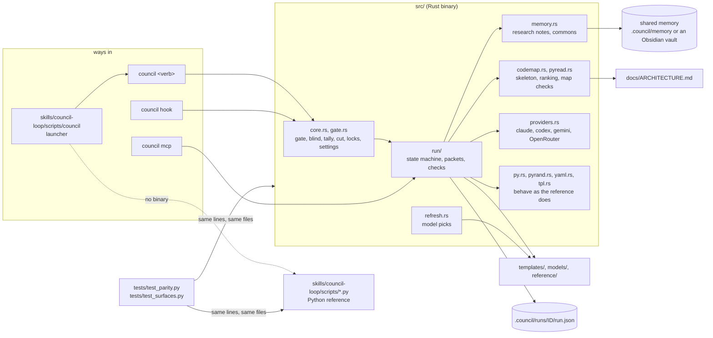

<!-- council-loop:map · written by hand (council map --install) on 2026-11-14 · checked against 52 source files · regenerate: council map -->
# Architecture of the Council Loop kit

> ELI5: a referee for a panel of AIs. One program keeps the checklist, counts the votes and files the notes; the AIs only think.

## Purpose and philosophy

The kit runs one process, the Council Loop, the same way in every AI tool: a gate sizes the work, a council of independent seats proposes, votes blind, attacks and refines, outside elders review, and the field is cut until one answer is left. Six ideas shape every file.

1. Judgment belongs to models; bookkeeping belongs to code. Anything that can be counted, checked or remembered is done by the program, never by a seat's memory.
2. One enforcement path. The command line, the MCP server, the plugin hook and CI all call the same functions, so a rule cannot hold in one place and fail in another.
3. State lives on disk. A run is a folder with one `run.json` that only the tool writes. The chair, an AI with a finite context, can stop, forget and resume.
4. Independence is protected by construction. Seats work in fresh contexts, cards are blinded, who wrote what is kept outside the project, and thoughts shared between members never enter a vote.
5. Two implementations, one behaviour. The program exists twice: a Rust binary, `council`, built from `src/`, and the Python reference in `skills/council-loop/scripts/`. They take the same commands, print the same lines and write the same files, and tests hold them to that. A change of behaviour is a change to both.
6. The binary stands alone. Templates, reference docs and model data are compiled into it by `build.rs`; a skill folder on disk overrides them. The Python reference needs only PyYAML.

## Bird's-eye view

Every surface is the one binary. `src/cli.rs` parses a verb and calls into `src/core.rs`, `src/gate.rs` or `src/run/`. The run loop renders packets from `skills/council-loop/templates/`, checks what seats return, and is the only caller that writes the shared memory (through `src/memory.rs`) and installs the codebase map (through `src/codemap.rs`). `src/providers.rs` is used only for seats that live behind another vendor's command-line tool or API. The launcher runs the binary when there is one and the Python reference when there is not. The parity tests play the same steps through both and compare everything.

## Code map

- `src/cli.rs`: every verb and its flags, and the mapping from an error to an exit code (2 = the person can fix it, 1 = a check failed or something broke). It must hold no rules.
- `src/core.rs`: settings for the support members (`members`, `beats_for`), blinding (`blind`, `seat_orders`), the vote count (`tally`, `protected`, `cut`), the protocol check (`check_run`) and test locks. It must not know about phases.
- `src/gate.rs`: `doctor` (what this machine can call) and `plan` (the tier, the models, the cost estimate).
- `src/run/`: the run as a state machine. `src/run/steps.rs` holds `cmd_init` and one `next_<phase>` per phase; `src/run/ingest.rs` holds one `ingest_<phase>` per phase and `collect`, the single point where a seat's output is accepted; `src/run/validate.rs` holds the checks; `src/run/prompts.rs` writes packets and holds `harvest`, which files what seats share; `src/run/seats.rs` assigns models to seats; `src/run/cut.rs`, `src/run/dispatch.rs` and `src/run/status.rs` are the remaining verbs. It must not count votes itself.
- `src/memory.rs`: the shared memory. `add_research` writes one fact per note, `write_commons` writes a run's page, `digest` picks what a packet shows, `retire` withdraws a fact without deleting it. It must not read `run.json` from disk; the run is passed in.
- `src/codemap.rs` and `src/pyread.rs`: read a repository without a model. `scan` lists symbols (Python through tree-sitter in `src/pyread.rs`, other languages by pattern), `ranking` orders files and names, `skeleton` and `focus_map` render them, `stale` decides whether a map is behind the code, `validate_map` and `install_map` guard the written map.
- `src/providers.rs`: one adapter per vendor tool, and `parse_json` for replies. It must not decide which model a seat gets.
- `src/refresh.rs`: builds `skills/council-loop/models/lock.yaml` from Artificial Analysis data and `skills/council-loop/models/policy.yaml`.
- `src/mcp.rs`: the MCP server: JSON-RPC over standard input and output, 23 tools, 4 resources, 1 prompt. Each tool calls the function behind the verb of the same name. It must hold no logic of its own, and it must never write anything but protocol messages to standard output.
- `src/hook.rs`: the Claude Code hook that denies edits to locked files.
- `src/py.rs`, `src/pyrand.rs`, `src/yaml.rs`, `src/tpl.rs`, `src/val.rs`, `src/clock.rs`, `src/out.rs`: the layer that makes the binary behave as the reference does: Python's text and number formatting, CPython's shuffle, PyYAML's reading and writing of YAML, `string.Template`, a frozen clock for tests, and output that the MCP server can capture.
- `src/assets.rs` and `build.rs`: the skill's files, compiled in, with a skill folder on disk winning.
- `skills/council-loop/scripts/`: the Python reference (`council.py`, `run.py`, `memory.py`, `codemap.py`, `providers.py`, `refresh_models.py`) and the launcher `skills/council-loop/scripts/council`.
- `mcp/server.py` and `hooks/protect_locked_files.py`: the Python reference for the other two surfaces.
- `bin/council` and `bin/council.cmd`: the launcher for a checkout or a plugin folder.
- `skills/council-loop/templates/`: the brief, the final write-up, an example config, and one packet per kind of seat in `skills/council-loop/templates/packets/`.
- `skills/council-loop/SKILL.md` and `skills/council-loop/reference/`: what an agent reads. The skill is short; detail is in the references.
- `agents/`: five subagent definitions (expert, red team, elder, researcher, mapper). Each takes one line: read and follow a packet.
- `tests/`: `tests/sim.py` plays seats with scripted answers and `tests/fakecli.py` stands in for vendor tools, so the whole loop runs without a model. `tests/test_parity.py` and `tests/test_surfaces.py` compare the two implementations; the other files test the reference directly.
- `docs/`: lessons, outcomes, records of the kit's own council runs, `docs/PORTING.md` (how the two implementations are kept the same, and where they differ) and this map.

## Interfaces

- Commands (`council <verb>`): `doctor`, `plan`, `init`, `next`, `status`, `dispatch`, `ingest`, `cut`, `note`, `deviation`, `audit`, `config`, `memory` (`status`, `setup`, `add`, `search`, `retire`, `import`), `map`, `models`, `blind`, `tally`, `check`, `lock-tests`, `verify-locks`, `ask`, `elders`, `refresh`, and in the binary only `mcp` and `hook`.
- MCP: the tools mirror those verbs (for example `council_init`, `council_next`, `council_ingest`, `council_memory_search`, `council_map`), plus resources for the skill, references, templates and model picks. Run-loop tools take `project_dir`.
- Files a chair edits: `brief.yaml`, `pool.json`, `candidates.json`, `final.md`, `retro.md` in the run folder. Everything else there is written by the tool or by one seat.
- Files a seat writes: exactly one output, `<seat>.out.json`, or `MAP.out.md` for the mapper.
- Settings: `.council/config.yaml` in a project and `config.yaml` under the user's `~/.council` folder, described in `skills/council-loop/templates/config.example.yaml`.
- Environment variables: `CLAUDECODE`, `COUNCIL_SEATS_VIA`, `COUNCIL_PRIVATE_DIR`, `COUNCIL_HOME`, `COUNCIL_MEMORY_DIR`, `COUNCIL_OBSIDIAN_VAULT`, `COUNCIL_OBSIDIAN_FOLDER`, `COUNCIL_ALLOW_LOCKED`, `COUNCIL_SKILL_DIR`, `COUNCIL_BIN`, `COUNCIL_PYTHON`, `OPENROUTER_API_KEY`, `AA_API_KEY`, and for tests `COUNCIL_NOW` and `COUNCIL_PARSERS`.

## Data and control flow

A run, step by step:

1. `init` calls `plan` for the tier, the models and the support members, pins the memory location, assigns seats and writes `run.json`.
2. The chair writes `brief.yaml` (rubric first). `ingest` freezes it.
3. Research: the researchers and, if the map is missing or behind the code, the mapper work in parallel. The research step files facts through `harvest` and installs the map.
4. Each loop: ideate, merge, vote, red team, fuse, rank, elders, cut. At every seat step `next` writes one prompt file per seat and `ingest` runs `collect`: check each output, move a rejected one aside with a retry prompt, count the call, hash the accepted file, harvest shared facts and notes.
5. `cut` applies the vote, the machine checks and the elder verdicts, writes the loop ledger, and either starts the next loop or names the winner.
6. The chair writes `final.md` and `retro.md`. At the retro the run is unblinded: the who-wrote-what mapping, the names on shared facts and the commons page are released together.

A vote, step by step: `blind` strips authors and assigns labels in an order drawn from a seed, `seat_orders` gives each voter its own reading order, `tally` reads ballots as head-to-heads weighted by each voter's stake in the two cards, and `protected` stops the vote from cutting a card it could not judge.

## Invariants

- Only the tool writes `run.json`, and only the run loop writes the shared memory during a run.
- A seat's output is accepted in one place, `collect`, or not at all.
- Tripwires only raise the tier. Only the requester's own words lower it.
- A blind vote packet carries no authors, no shared thoughts and no codebase context.
- Facts need a source; a fact from recall is labelled and marked as not re-checked.
- Voting seats are unnamed in the shared memory until the run ends.
- The two implementations agree. For the same steps they print the same lines and write the same files, so a run started by one can be finished by the other at any step. `tests/test_parity.py` holds this; the differences that remain are listed in `docs/PORTING.md`.
- What counts as a structural change of a codebase comes from the built-in readers only, so two machines, and the two implementations, agree on whether a map is stale.
- A map or a note that a person wrote is never overwritten.
- Text is UTF-8 and lines end in `\n`, in files and on the console, on every system. Paths inside the project are stored and shown with forward slashes. Files from other tools are read tolerantly (CRLF, a byte-order mark, UTF-16), and lock hashes ignore CRLF. So a run made on one system reads the same on another, and both implementations write the same bytes there. `tests/test_portability.py` holds this for the reference, and the parity tests for the pair.
- Bad input from a model or a person is an answer, never a crash: the tool says what is wrong, or reads the value as text.

## Extending it

Change both implementations, then let `tests/test_parity.py` say whether they still agree.

- A new verb: a variant in `src/cli.rs`, a subparser in `council.py`, a tool in `src/mcp.rs` and `mcp/server.py`, and a step in a parity scenario.
- A new language for the map: a pattern reader in `src/codemap.rs` and in `codemap.py`.
- A new vendor: a branch in `command` in `src/providers.rs` (`_command` in `providers.py`) and a route in `how` in `src/run/seats.rs`.
- A new kind of support member: a role in `agent` in `src/run/mod.rs`, a packet in `skills/council-loop/templates/packets/`, a check in `src/run/validate.rs`, and a branch in `seat_files`.
- More researchers or different beats: no code; set `members.research` in the config.
- A new model family or profile: edit `skills/council-loop/models/policy.yaml` and run `council refresh`.

## Performance and cost

The program is cheap: the binary answers in a few milliseconds and scans this repository in well under a second. Model calls are the cost. One Lite run measured 9 seat calls and about 1.27 million tokens, most of it per-call overhead of the host. The gate prints `calls~` and `tokens~` before anything is spent, from numbers in `skills/council-loop/models/policy.yaml`; the researcher and mapper figures there are assumptions until measured. The mapper runs only when the structure changed (a new test or a change inside a function is not a change of structure), and the ranked code list in packets is capped by a token budget.

## Where to change what

| To do this | Start in |
| --- | --- |
| Change how votes are counted | `tally` in `src/core.rs` and in `skills/council-loop/scripts/council.py` |
| Add or reorder a phase | `src/run/steps.rs` and `src/run/ingest.rs`; `next_*` and `ingest_*` in `skills/council-loop/scripts/run.py` |
| Change what a seat is told | `skills/council-loop/templates/packets/` (no code) |
| Change what is shared between members | `harvest` and `memory_block` in `src/run/prompts.rs` |
| Change the note format | `write_fact` in `src/memory.rs` |
| Change how code is ranked | `ranking` in `src/codemap.rs` |
| Add a setting | `members` in `src/core.rs` and `skills/council-loop/templates/config.example.yaml` |
| Expose a verb over MCP | `tools` in `src/mcp.rs` and `mcp/server.py` |
| Check that both implementations still agree | `tests/test_parity.py` |

## Open questions

- The researcher and mapper seats have been exercised with scripted answers only. Their real token cost and the quality of their output are not yet measured.
- The Obsidian `Research.base` file follows the documented syntax but has not been opened in Obsidian from this repository's tests.
- Windows builds of both implementations pass the test suite under Wine, which is not Windows. Nothing has run on a real Windows or macOS machine yet; CI runs both.
