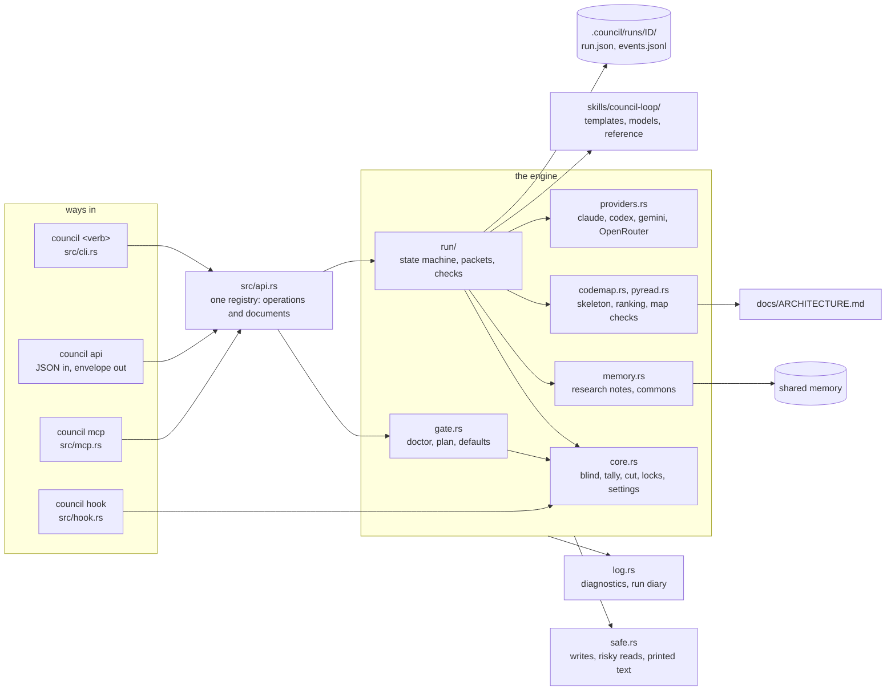

<!-- council-loop:map · written by hand (council map --install) on 2026-11-14 · checked against 42 source files · regenerate: council map -->
# Architecture of the Council Loop kit

> ELI5: a referee for a panel of AIs. One program keeps the checklist, counts the votes and files the notes; the AIs only think.

## Purpose and philosophy

The kit runs one process, the Council Loop, the same way in every AI tool: a gate sizes the work, a council of independent seats proposes, votes blind, attacks and refines, outside elders review, and the field is cut until one answer is left. The program in this repository, `council`, is the referee of that process. Six ideas shape the code.

1. Judgment belongs to models; bookkeeping belongs to code. Anything that can be counted, checked or remembered is done by the program, never by a seat's memory.
2. One list of operations, many doors. Everything the program can do is an entry in one registry (`src/api.rs`). The command line, the JSON API and the MCP server are three ways to call the same entries, so a rule cannot hold behind one door and fail behind another.
3. State lives on disk. A run is a folder with one `run.json` that only the program writes. The chair, an AI with a finite context, can stop, forget and resume.
4. Independence is protected by construction. Seats work in fresh contexts, cards are blinded, who wrote what is kept outside the project, and thoughts shared between members never enter a vote.
5. Trust little. The program runs inside projects it did not write and reads text from the open web. It writes only where it should, checks state before believing it, and keeps the seats that read the web apart from the seats that read the code. One module, `src/safe.rs`, is the door for every write and every risky read.
6. The binary stands alone and starts fast. Templates, reference pages and model data are compiled in by `build.rs`; a skill folder on disk overrides them. Nothing else is needed at run time, and a start costs about two milliseconds, because the hook runs it around every tool call.

## Bird's-eye view

`src/cli.rs` parses a verb and calls the engine. `council api` and `council mcp` call the same engine through the registry in `src/api.rs`, which checks arguments, finds the project, runs the operation and wraps the answer in one envelope. The run loop renders packets from `skills/council-loop/templates/`, checks what seats return, and is the only writer of run state.

## Code map

- `src/cli.rs`: every verb and its flags, and the mapping from an error to an exit code (2 = the caller can put it right, 1 = a check failed or the machine refused). It must hold no rules.
- `src/api.rs`: the API surface. `operations` is the registry: for each operation its arguments (`Param`, `Kind`), its `Effect` (reads, writes, sends) and what it answers. `call` checks arguments, applies the caller's fence (`Context`), runs the operation and builds the envelope. `documents` lists what can be read by address and `document` reads one. It must hold no rules of the council.
- `src/mcp.rs`: the MCP server, generated from `src/api.rs`: tools from the operations, resources from the documents, two prompts, logging and progress. `Options` holds its configuration. It must add nothing the API does not have.
- `src/hook.rs`: the Claude Code hook. Before a tool runs it guards locked files and keeps council seats in their lane; after a shell line it compares locked files with their hashes.
- `src/gate.rs`: `doctor` (what this machine can call, what each mode costs) and `plan` (the tier, the models, the cost estimate, the cheapest default).
- `src/core.rs`: settings for the support members (`members`), tripwires, blinding (`blind`, `seat_orders`), the vote count (`tally`, `cut`), the protocol check (`check_run`) and test locks (`lock_files`, `verify_locks`). It must not know about run folders.
- `src/run/`: the run as a state machine. `src/run/steps.rs` holds `cmd_init` and one step per phase; `src/run/ingest.rs` checks what came back, with `collect` the single point where a seat's output is accepted; `src/run/validate.rs` holds the checks; `src/run/prompts.rs` renders packets; `src/run/seats.rs` routes seats; `src/run/dispatch.rs` calls vendors; `src/run/cut.rs` ends a loop; `src/run/status.rs` holds `status`, `audit`, `log` and the snapshot the API returns.
- `src/memory.rs`: the shared memory. `add_research` writes one fact per note, `write_commons` writes a run's page, `digest` picks what a packet shows, `retire` withdraws a fact without deleting it, `trusted` decides whether a memory folder may be used.
- `src/codemap.rs` and `src/pyread.rs`: read a repository without a model. `scan` lists symbols (Python through tree-sitter in `src/pyread.rs`, other languages by pattern), `ranking` orders files and names, `skeleton` and `focus_map` print them, `validate_map` checks a written map.
- `src/providers.rs`: one adapter per vendor tool, and `parse_json` for replies. It must not decide which model a seat gets.
- `src/refresh.rs`: builds `skills/council-loop/models/lock.yaml` from Artificial Analysis data and `skills/council-loop/models/policy.yaml`.
- `src/safe.rs`: the one door for writes (`write_text`, `append_line`, `make_dir`, `guard`), for reads of things a project controls (`read_own`, `read_capped`, `plain_file`), for text that will be printed (`shown`), for git (`git`) and for patterns from a settings file (`project_pattern`).
- `src/log.rs`: diagnostics with levels and redaction (`diag!`), and the run diary (`record`, `events`).
- `src/demo.rs`: the scripted council behind `council demo`, also used by the tests (`script`, `Stage`). `src/welcome.rs`: the first-run check.
- `src/py.rs`, `src/pyrand.rs`, `src/yaml.rs`, `src/tpl.rs`, `src/val.rs`, `src/clock.rs`, `src/out.rs`: formatting, the seeded shuffle, YAML, templates, JSON helpers, the clock and output capture. Their behaviour is fixed by the file formats, which began as Python's.
- `src/assets.rs` and `build.rs`: the skill's files, compiled in, with a skill folder on disk winning.
- `skills/council-loop/SKILL.md`, `skills/council-loop/reference/` and `skills/council-loop/templates/`: what an agent reads, and one packet per kind of seat in `skills/council-loop/templates/packets/`.
- `agents/`: six subagent definitions (expert, red team, elder, researcher, historian, mapper). Each takes one line: read and follow a packet. `hooks/hooks.json` wires the hook.
- `tests/`: `tests/scenarios.rs` replays recorded runs from `tests/cassettes/` and plays live ones; `tests/security.rs` keeps every attack of the security review; `tests/surfaces.rs` covers the API, the server, the hook and the demo; `tests/fuzz.rs` feeds damaged input to every reader; `tests/speed.rs` holds time limits; `tests/notices.rs` keeps the licence list current.
- `docs/`: tutorials, `docs/operations.md`, `docs/testing.md`, records of the kit's own council runs, and this map.

## Interfaces

- Commands (`council <verb>`): `demo`, `doctor`, `plan`, `init`, `next`, `status`, `dispatch`, `ingest`, `cut`, `note`, `deviation`, `audit`, `log`, `config`, `memory` (`status`, `setup`, `add`, `search`, `retire`, `import`), `map`, `models`, `blind`, `tally`, `check`, `lock-tests`, `verify-locks`, `ask`, `elders`, `refresh`, `api`, `mcp`, `hook`.
- API: 27 operations in four groups (`run`, `memory`, `map`, `blocks`). Every answer is the envelope `{ok, code, output, data, run}`. Documents have addresses such as `skill://council-loop/SKILL.md` and `council://run/current`; the operation `read` hands one out.
- MCP: one tool per operation (`council_<operation>`), one resource per document, the prompts `council_loop` and `council_resume`. Options: `--project`, `--read-only`, `--no-dispatch`, `--toolsets`, `--tools`, `--deny-tools`, `--output-schemas`.
- Files a chair edits: `brief.yaml`, `pool.json`, `candidates.json`, `final.md`, `retro.md` in the run folder. Everything else there is written by the program or by one seat.
- Files a seat writes: exactly one output, `<seat>.out.json`, or `MAP.out.md` for the mapper.
- Settings: `.council/config.yaml` in a project and `config.yaml` under the user's `~/.council` folder, described in `skills/council-loop/templates/config.example.yaml`. Only the user's file may set `defaults`, `mcp` and a memory folder outside the project.
- Environment variables: listed in `skills/council-loop/reference/commands.md`.

## Data and control flow

A run, step by step:

1. `init` calls `plan` for the tier, the models and the support members, pins the memory location, assigns seats and writes `run.json`.
2. The chair writes `brief.yaml` (rubric first). `ingest` freezes it.
3. Research: the researchers and, if the map is missing or behind the code, the mapper work in parallel. The research step files facts and installs the map.
4. Each loop: ideate, merge, vote, red team, fuse, rank, elders, cut. At every seat step `next` writes one prompt file per seat and `ingest` runs `collect`: check each output, move a rejected one aside with a retry prompt, accept the rest.
5. `cut` applies the vote, the machine checks and the elder verdicts, writes the loop ledger, and either starts the next loop or names the winner.
6. The chair writes `final.md` and `retro.md`. At the retro the run is unblinded: the who-wrote-what mapping, the names on shared facts and the commons page are released together.

Every command of the run loop is recorded in the run's `events.jsonl` with its outcome and the time it took.

A call through the API: `call` looks the operation up, checks every argument against its declared kind, resolves the project (and refuses one outside the caller's fence, as well as any path argument outside it), runs the operation with its printed output captured, and returns the envelope. A panic inside one operation is caught there, so a server survives it.

## Invariants

- Only the program writes `run.json`, and only the run loop writes the shared memory during a run.
- A seat's output is accepted in one place, `collect`, or not at all.
- Writes go through `src/safe.rs`: inside the project, the user's own folders or the memory folder the user's settings name, and never through a symbolic link.
- State read from a project (`run.json`, `CURRENT`, `locks.json`, settings) is checked before it is used.
- Tripwires only raise the tier. Only the requester's own words lower it. Only the user's own settings change what a run costs by default.
- A blind vote packet carries no authors, no shared thoughts and no codebase context.
- Facts need a source; a fact from recall is labelled and marked as not re-checked.
- A seat that searches the web does not read the project, and a seat that reads the project has no web tools.
- Operations exist once, in `src/api.rs`; the server and the command line cannot differ in what they offer.
- A map or a note that a person wrote is never overwritten.
- Text is UTF-8 and lines end in `\n`, in files and on the console, on every system. Paths inside the project are stored and shown with forward slashes.
- Bad input from a model, a person or a project is an answer, never a crash or a hang.
- No test calls a model.

## Extending it

- A new operation: one entry in `operations` in `src/api.rs` and one verb in `src/cli.rs`. The MCP tool and its schema follow. A unit test fails if the entry is not fully described.
- A new document: one entry in `documents` and one branch in `document`, both in `src/api.rs`.
- A new language for the map: a pattern reader in `src/codemap.rs`.
- A new vendor: a branch in `command` in `src/providers.rs` and a route in `src/run/seats.rs`.
- A new kind of support member: a role in `agent` in `src/run/mod.rs`, a packet in `skills/council-loop/templates/packets/`, a check in `src/run/validate.rs`, and an agent file in `agents/`.
- More researchers or different beats: no code; set `members.research` in the config.
- A new model family or profile: edit `skills/council-loop/models/policy.yaml` and run `council refresh`.
- Any change to what the program prints: accept the recordings (`COUNCIL_ACCEPT=1 cargo test --test scenarios`) and review the diff. See `docs/testing.md`.

## Performance and cost

The program is cheap: it starts in about 2 ms, the hook answers in about 4 ms with a thousand locked files, and a project of 600 source files is planned in under 100 ms. `tests/speed.rs` holds limits on these and `docs/operations.md` lists the figures. Model calls are the cost. One Lite run measured 9 seat calls and about 1.27 million tokens, most of it per-call overhead of the host.

## Where to change what

| To do this | Start in |
| --- | --- |
| Change how votes are counted | `tally` in `src/core.rs` |
| Add or reorder a phase | `src/run/steps.rs` and `src/run/ingest.rs` |
| Change what a seat is told | `skills/council-loop/templates/packets/` (no code) |
| Change what is shared between members | `src/run/prompts.rs` |
| Change the note format | `write_fact` in `src/memory.rs` |
| Change how code is ranked | `ranking` in `src/codemap.rs` |
| Add a setting | `members` in `src/core.rs` and `skills/council-loop/templates/config.example.yaml` |
| Add an operation, an argument or a document | `src/api.rs` |
| Change what the server offers or how it is configured | `Options` in `src/mcp.rs` |
| Change what the hook stops | `src/hook.rs` |
| Change where files may be written or how they are read | `src/safe.rs` |
| Change the default mode or profile | `src/gate.rs` |
| Add a scenario or accept a changed recording | `tests/scenarios.rs` |

## Open questions

- The researcher and mapper seats have been exercised with scripted answers only. Their real token cost and the quality of their output are not yet measured.
- No real model has run through this binary. The one real council so far ran on version 0.2.
- The Obsidian `Research.base` file follows the documented syntax but has not been opened in Obsidian from this repository's tests.
- The Windows build is tested under Wine, which is not Windows, and the recorded scenarios run on Unix only. Nothing has run on a real Windows or macOS machine yet; CI runs both.
