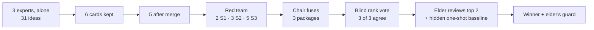

# The kit reviews itself: Lite council run of 13 November 2026

**ELI5:** We asked the AI team to check its own rulebook. Nine agents worked through the real
process. They found thirteen real faults, most by running the code, and the worst one was in the
referee. All thirteen are fixed and tested in v0.2.0.

Run id `261113-183103-take-turn-review`. The complete record (every packet, every seat's raw
output, the ballots, the ledger, the final and the retro) is in
[`docs/runs/261113-183103-take-turn-review/`](runs/261113-183103-take-turn-review/). Absolute
paths in that copy are shortened to `<repo>`.

## The ask

> Take a turn to review and iterate. Im handing the reigns to you, to make this more useful for
> yourself. Be free

The chair (Claude Fable 5.2) restated it as: decide the changes that would most improve the kit for
the AI that runs it, the chair and the seats, before release.

```text
GATE tier=lite mode=fanout:claude profile=balanced loops<=1 calls~9 rel_cost=1.86 (chair: stakes=medium)
```

## What ran



| Step | Seat | Model (effort) | Tokens | Time |
| --- | --- | --- | ---: | ---: |
| Ideate | L1 Executor ergonomics | Claude Fable 5.2 (low) | 96,432 | 45 s |
| Ideate | L2 Integrity under pressure | Claude Opus 5.5 (high) | 120,935 | 88 s |
| Ideate | L3 Cost and simplicity | Claude Sonnet 5.5 (xhigh) | 225,110 | 8 min |
| Control arm | CTRL, one shot, hidden from the chair | Claude Fable 5.2 (high) | 150,811 | 3 min |
| Red team | RT | Claude Opus 5.5 (max) | 241,663 | 15 min |
| Rank vote | L1, L2, L3 | as above | 192,926 | 18 s |
| Elder | EA | Claude Opus 5.5 (max) | 241,329 | 16 min |
| **Total** | **9 agent calls** | | **1,269,206** | about 40 min of agent time end to end |

Tokens are what the host reported for each agent, start-up overhead included. A blind vote cost
about 64,000 tokens for a packet of about 2,000: almost all of it was overhead. The chair's own
tokens are not in the table.

## What it found

Every row was checked against the code before it was fixed. "Reproduced" means the agent ran the
kit in a scratch copy and saw the failure.

| # | Fault | Found by | Fix in v0.2.0 | Regression test |
| --- | --- | --- | --- | --- |
| 1 | The vote count scored any card that several experts co-wrote as 0.0, so label order picked the winner | Red team (reproduced), and the one-shot baseline on its own | Votes are counted as head-to-heads weighted by stake | `test_tally_cowritten_cards_still_get_a_fair_count` |
| 2 | A ballot that skipped or misspelt a label voted that card last | Red team (reproduced) | A gap is no opinion; label spelling is cleaned | `test_tally_gap_is_no_opinion_and_labels_are_cleaned` |
| 3 | A head-to-head nobody could judge counted as even, so a favourite could be cut unseen | Elder (reproduced) | Stake weights, plus a guard: a vote may not cut what it could not judge | `test_vote_may_not_cut_what_it_could_not_judge` |
| 4 | The printed retry step for a CLI seat answered "nothing to dispatch" | Two experts, independently (one reproduced it) | A rejected output is moved aside and the retry runs | `test_cli_seats_dispatch_and_a_rejected_one_can_really_be_retried` |
| 5 | The identity-leak check fired on ordinary phrases such as "seat call" | Expert (reproduced, 5 of 5) | It matches first-person talk, claimed roles and real seat ids only | `test_leak_check_flags_identity_and_not_ordinary_words` |
| 6 | `--force` dropped every pending seat, including the control arm | Red team (reproduced) | `--drop <seat> --reason` drops only named seats | `test_drop_names_the_seat_and_cannot_take_the_control_arm_with_it` |
| 7 | An elder that skipped one score crashed the run after its costliest step | Red team (reproduced) | Scores are read safely; a gap is a warning | `test_elder_scores_may_have_gaps_without_crashing` |
| 8 | After a restart, `next` re-spawned every seat of the step | Expert | `next` lists only the seats that still owe an output | `test_next_after_a_restart_lists_only_the_seats_still_owed` |
| 9 | The chair typed each card's authors by hand, twice; a typo let experts rank their own work | Expert | Authors are derived from `from` and `parents`; a kept card cannot be lost | `test_authors_come_from_provenance_not_from_typing` |
| 10 | Every voter saw the cards in the same order | Expert; the red team showed that rotating by one fails at 21 cards | Evenly spaced order for each voter | `test_seat_orders_are_evenly_spaced` |
| 11 | Seats were sent back for idea lines over 25 words, which nothing downstream reads | Expert (measured on its own drafts) | A warning, never a retry | `test_long_idea_lines_warn_and_never_cost_a_respawn` |
| 12 | The control card was blind-checked too late, and a lost one was dropped silently while the record said the council won | One-shot baseline (first half), elder (reproduced) | The control arm is checked at ingest, hashed and read back from disk | `test_sealed_control_arm_cannot_vanish_silently` |
| 13 | The retry counter grew every time `ingest` was run | Elder (reproduced) | A rejection is counted once per rejected output | `test_rejected_output_is_moved_aside_and_counted_once` |

Three more came from the experts' idea lists and the red team's minor findings, and were cheap
enough to take: a winner the elders never reviewed is now a judgment point, `dispatch` stops after
two rejections, and seat friction notes are recorded once.

## The decision

The chair fused the five pooled cards and the red team's fixes into three packages of rising size.
All three experts ranked them the same way, blind:

| Rank | Package | Score |
| --- | --- | ---: |
| 1 | Five proven defects plus four changes that take typing off the chair | 0.78 |
| 2 | Full hardening, twelve changes at once | 0.47 |
| 3 | Five proven defects only | 0.25 |

The elder preferred the first package to the second and to the hidden one-shot baseline, with
confidence 0.6 and the verdict "revise": it asked for the guard in row 3 and the sealed control arm
in row 12. Both were added. Re-counting the same ballots with the final vote counter gives the
same order (0.79, 0.49, 0.23).

**Council against one model.** The one-shot baseline (one agent, 150,811 tokens) found the most
serious fault, row 1, on its own, plus half of row 12. The council found row 1 too, plus the other
twelve, for 8.4 times the tokens. For "find the worst bug", one strong model was enough. For "find
what is wrong", it was not.

## Where the run left the protocol

The run logged three deviations, and they are repeated here as the protocol asks.

1. **The referee was patched mid-run.** The vote counter was replaced after the red team's first
   finding and before any ballot was cast. Counting with a counter known to be wrong would have
   been worse.
2. **The chair saw the control arm early.** It opened the elder packet to check it. No candidate
   was edited afterwards, because the run had one loop. The tool now warns against this.
3. **A judgment point was settled without the requester.** An elder S1 was open at the cut and the requester could
   not be asked. The safer option was taken: build the winner with the elder's fix. Nothing was
   released.

Two limits, also for the record: the one elder was from the chair's own lab, because no OpenAI or
Gemini model could be reached from the sandbox; and the codex and gemini adapters are still tested
only against a fake CLI.

## What was parked, and why

- **Different label letters for each voter.** The suspected bias is real in multiple-choice
  answering ([Zheng et al., ICLR 2024](https://arxiv.org/abs/2309.03882v4)) but has not been
  measured for ranking here. Measure first.
- **Overlap warnings at merge.** Low value now that every kept card must reach the pool.
- **Routing vote, rank and elder seats through a lean no-tool call.** It is the largest cost lever
  found: 54 of the 76 calls in a Full run are judges, and each paid about 60,000 tokens of start-up
  overhead here. It could not be tested in this sandbox.

## Lessons proposed

- [L-20261113-4] Before releasing a change to the referee scripts, run a Lite council on the kit itself.
- [L-20261113-5] Tell the red team and the elders to reproduce claims by running code in a scratch copy.
- [L-20261113-6] Count tokens, not calls, and route judges through a lean call where one exists.
