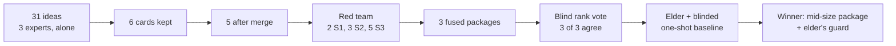

# Ship the mid-size fix package: five proven defects plus four changes that take work off the chair

> Decided unattended. The requester was not asked at the one judgment point (an elder S1 was open). The safer
> option was taken: build the winner with the elder's fix grafted in. Nothing is released yet, so every
> step can be undone.

**Answer:** Fix the five defects the council reproduced, then make four structural changes that remove
typing and guesswork from the AI that runs the kit. Add the elder's guard: a vote may never cut a card
it could not judge. Park the rest, with reasons. All three experts ranked this package first, blind, and
the elder preferred it to both the bigger package and the one-shot baseline.

**ELI5:** Fix what we watched break, make the rulebook do more of the bookkeeping, and never let a vote
throw out an idea nobody could fairly judge.

## What gets built

| # | Change | Why |
| --- | --- | --- |
| 1 | Votes are counted as head-to-heads, weighted by stake | Co-written cards scored 0.0 under the old count; a ballot gap counted as a last place |
| 2 | A rejected output is moved aside; missing CLI agents get a dispatch line | The printed retry step did nothing ("nothing to dispatch") |
| 3 | The identity-leak check matches real ids only | It fired on ordinary phrases, five of five tried |
| 4 | Elder scores are read safely | One missing score crashed ingest after the costliest calls |
| 5 | Over-long idea lines warn instead of rejecting | Each rejection is a full respawn for data nobody reads |
| 6 | `next` lists only the agents still missing | A restart re-spawned every agent of the step |
| 7 | `ingest --drop <agent>` replaces bare `--force` | `--force` could silently drop the control arm |
| 8 | Authors are derived from `from` and `parents` | The chair typed them by hand, twice; a typo let experts rank their own work |
| 9 | Each voter reads the cards in its own evenly spaced order | One shared order gave the first card the same boost on every ballot |
| + | Elder's guard: a vote never cuts what it could not judge | A favourite written by 6 of 7 experts could lose with no one able to vote on it |
| + | The control arm is sealed: checked at ingest, hashed, never dropped silently | A resumed run could lose the baseline and still record "the council won" |
| + | Rejections are counted per distinct output, not per ingest call | Re-running ingest inflated the retry count |

## Why this wins
- Every item has a reproduction or a failing probe. The red team and the elder ran the code in scratch
  copies; nothing here rests on opinion alone (sources: `loop-1/redteam/RT.out.json`, `loop-1/elders/EA.out.json`).
- Two experts found the dead retry independently (cards L1#1 and L3#2). Independent agreement is the
  strongest signal this process produces.
- Blind rank vote: 3 of 3 ballots put it first, agreement 1.0, 7 head-to-heads counted and 2 sat out.
- The elder (Claude Opus 5.5, max) scored it 8, 7, 8, 9, 8 on R1 to R5 and preferred it to the
  one-shot baseline, with confidence 0.6 and one S1 that is now part of the build.

## What we considered and dropped
| Option | Why it lost |
| --- | --- |
| Fix the five proven defects, then release | cut in loop 1: last on all 3 ballots. It leaves `--force` able to drop the control arm and keeps hand-typed authors. |
| Full hardening in dependency order | cut in loop 1: second on all 3 ballots. Twelve changes at once, and it adds per-voter label letters for a bias nobody has measured here. |

Deferred, with reasons: per-voter label letters (suspected bias, unmeasured; measure first), overlap
warnings at merge (low value once every kept card must reach the pool), judge calls routed through a
lean no-tool path (largest cost lever found, but untestable in this sandbox).

## Risks and how we handle them
| Risk | Severity | Mitigation | Owner |
| --- | --- | --- | --- |
| The old vote count scored co-written cards 0.0 and ranked by label order | S1 | Replaced before any ballot was cast; unit tests cover the red team's cases | Chair, this release |
| A ballot gap or a misspelt label voted that card last | S1 | A gap is now no opinion; label spelling is cleaned; gaps appear in the ledger | Chair, this release |
| `--force` dropped every pending agent, including the control arm | S2 | Change 7: `--drop` names the agent and refuses while others are pending | Chair, this release |
| An elder that skipped one score crashed ingest | S2 | Change 4, with tests for a missing card and a missing criterion | Chair, this release |
| Rotating order by one fails with 21 cards and 7 voters | S2 | Change 9 uses evenly spaced offsets, tested at 21 by 7 | Chair, this release |
| Elder S1: a head-to-head nobody could judge counted as even, so a favourite could be cut unseen | S1 | Stake-weighted count plus the guard: such cards stay on the shortlist and go to the elders; a deviation is logged | Chair, this release |
| Elder S2: the control card was blind-checked too late, and a lost private store dropped it silently | S2 | The control arm is sealed (checked at ingest, hashed, read back from disk) | Chair, this release |
| Elder S2: retry counts grew with every ingest call | S2 | Rejected outputs are moved aside and counted once each | Chair, this release |
| The codex and gemini adapters have still never run against the real CLIs | S2 | Not fixed here. A fake CLI on PATH now tests dispatch, parse and retry; the live paths stay labelled untested | the requester (needs the CLIs installed) |

## Dissent (recorded, not averaged away)
- No elder preferred another option. The elder's verdict on the winner was "revise", not "ship": it is
  built with the elder's fix, not as first written.
- One elder only, from the same lab as the chair (Anthropic). No OpenAI or Gemini model was reachable
  in this sandbox, so this run had no cross-lab review. No stand-in seats were used.
- The one-shot baseline found the most serious defect (the vote count) on its own, for about one
  eighth of the tokens. The council found it too, plus a dozen more.

## How we'll know (falsifiable)
- Success metric at 30 and 90 days: in the next five real runs, zero steps where the chair must guess
  (no "nothing to dispatch" loop, no hand-edited authors, no restart that re-spawns finished agents),
  and zero rejections for idea length.
- Check today: every change above has a unit test; the whole suite passes; re-counting this run's
  ballots with the final counter gives the same order (C3, C2, C1).
- Kill criterion: if two of the next five runs still stall at a retry or a restart, revert changes 6
  and 7 and redesign the resume path.

## Next steps
- [ ] Build changes 1 to 9 and the three grafts, one test each.
- [ ] Re-count this run's ballots with the final counter and record the result.
- [ ] Add the run's measured cost to the docs: 9 agent calls, about 1.27 million tokens.
- [ ] The requester: install the codex and gemini CLIs once and run `council.py doctor --probe`.

## Run facts
- GATE tier=lite mode=fanout:claude profile=balanced loops<=1 calls~9 rel_cost=1.86 (chair: stakes=medium)
- Winner: Defects plus four changes that remove typing
- Control arm (one-shot baseline, judged blind by the elders): the council's answer was preferred by 1 of 1 elder(s)
- Seats: CTRL=Claude Fable 5.2 (high); EA=Claude Opus 5.5 (max); L1=Claude Fable 5.2 (low); L2=Claude Opus 5.5 (high); L3=Claude Sonnet 5.5 (xhigh); RT=Claude Opus 5.5 (max)
- Measured: 9 agent calls, 1,269,206 tokens (ideate 442,477; control 150,811; red team 241,663; rank vote 192,926; elder 241,329). A blind vote costs about 64,000 tokens here, almost all of it start-up overhead.
- Deviations: (1) the vote counter was replaced before any ballot was cast, after red-team finding 1; (2) the chair opened the elder packet and so saw the blinded control arm before the elder review; no candidate was edited afterwards; (3) an S1 was open at the cut and the requester could not be asked, so the safer option was taken.
