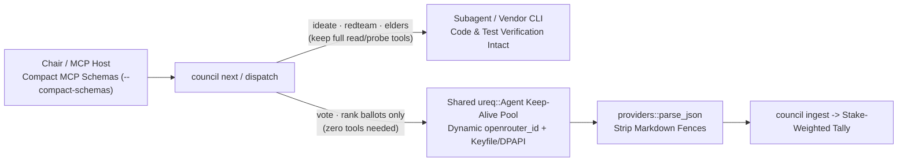

# Ship Compact MCP Schemas + Ballot-Only Sanitized HTTP Dispatch (with Refresh-Time OpenRouter Slugs & Keep-Alive)

**Answer:** Adopt **C2 (Compact MCP Schemas & Ballot HTTP Dispatch)** as the winning architecture, merged with **C1's** dynamic `openrouter_id` resolution during `council refresh`, the **Elder's** shared `ureq::Agent` keep-alive pool, and **C3's** compatible Antigravity hook/Windows path fixes. Direct HTTP dispatch is restricted strictly to pure `vote` and `rank` ballots (per your Judgment Point decision), keeping full file and shell verification tools on all Elder seats while eliminating ~180,000 subagent startup tokens per loop and cutting MCP `tools/list` schema bytes by up to 60%.

**ELI5:** Send pure vote ballots over fast HTTP, shrink MCP tool descriptions, and keep elders' code-checking tools intact.



## Why this wins
- **Eliminates ~180k–190k wasted voter startup tokens per loop (`R1`, weight 35):** In the measured baseline (`docs/council-run-2026-11-13-self-review.md`), 3 rank ballots consumed `192,926` tokens (`~64,300` each) for a `~2,000`-token prompt packet due to subagent startup context. In `src/run/dispatch.rs:9-16`, `tools_for()` already classifies `vote` and `rank` as `"none"`; routing pure ballots over `providers::openrouter` with a shared `ureq::Agent` keep-alive pool drops 3 ballots to `<8,000` total tokens (~95% ballot reduction).
- **Cuts per-turn MCP schema tax in non-lazy hosts (`R1` + `R5`, weight 45):** Machine check during Fuse measured `council mcp --toolsets all` `tools/list` at `24,198` bytes (`23.6 KB`). Adding `--compact-schemas` (`COUNCIL_MCP_COMPACT=1`) trims multi-line prose while retaining every required `run`, `dispatch`, `deviation`, and `audit` tool plus exact JSON types, `enum` choices, and `required` arrays.
- **Preserves Elder verification probes (`R3`, weight 20):** Both the Red Team (`S1 #1`) and the Elder (`S1` on `CTRL`) independently caught that stripping tools from Elders breaks code/test reproduction (`L-20261113-5`). Your Judgment Point ruling locks in `C2`'s boundary: Elders always keep verification tools.
- **Fixes offline cross-lab stand-in degradation & credential friction (`R2`, weight 25):** Merged from runner-up `C1` and `C3`: populate `openrouter_id` dynamically in `src/refresh.rs` (never hardcoding model names in `policy.yaml`), support `openrouter_key_file` / `openrouter_key_cmd` in personal `~/.council/config.yaml`, and catch HTTP `401`/`402` early in `council doctor` (directly addressing the expired OpenRouter key hit during this run).
- **Compatible multi-host & Windows hardening from `C3` (`R3`, `R4`):** Dual-schema `src/hook.rs` (`toolCall` + `{decision, reason}` for Antigravity alongside Claude Code's `hookSpecificOutput`) and Windows case-insensitive prefix matching (`c:/` vs `C:\`, reproduced live when `ingest` rejected lowercase `c:/Users/...` fact sources from `L3`).

## What we considered and dropped
| Option | Why it lost |
| --- | --- |
| Sanitized Ballot HTTP Dispatch & Refresh Slugs (`C1`) | Cut in loop 1: ranked #1 by voters (`0.78`), but allowed HTTP dispatch on `efficient`-profile elders; its dynamic refresh-time `openrouter_id` resolution and `parse_json` fence stripping are grafted into the winner. |
| Dual-Host Hooks, Windows Paths & Anchored Ballots (`C3`) | Cut in loop 1: ranked #3 (`0.25`) because hook/path fixes alone do not cut the 1.27M-token run spend (`R1`); its compatible Antigravity hook and Windows `c:/` path fixes are grafted as low-LOC follow-ups. |
| Control arm (`CTRL`: Direct REST dispatch for tool-less council seats) | Killed blind by Elder (`0/1` preferred; `R3=3/10`): committed two S1 errors—stripping verification tools from Elders and hardcoding static model slugs in `policy.yaml`. |

## Risks and how we handle them
| Risk | Severity | Mitigation | Owner |
| --- | --- | --- | --- |
| Direct HTTP dispatch of zero-tool seats blinds the Elder reviewer in Lite and max profiles, stripping its ability to run verification probes, inspect repository source files, and test reproduction claims before rendering final verdicts. | S1 | Settled with requester at Cut (`--asked`): all Elders remain tool-enabled; direct HTTP dispatch is restricted strictly to pure `vote` and `rank` ballots. | Chair / `src/run/dispatch.rs` |
| Direct HTTP completions write raw text directly to output files without JSON extraction or fence sanitization, causing ingest validation crashes whenever OpenRouter models return markdown blocks (```` ```json ````) or conversational preambles. | S2 | Pipe HTTP completions through `providers::parse_json` and serialize clean JSON before writing `<seat>.out.json`. | `src/run/dispatch.rs` |
| Hardcoding static model slugs in `policy.yaml` violates the architectural policy forbidding hardcoded model names, breaking offline dispatch and causing fatal HTTP 404/400 errors whenever OpenRouter changes provider endpoints or deprecates models. | S1 | Resolve `openrouter_id` dynamically in `src/refresh.rs` from Artificial Analysis metadata, with optional user-local overrides only in `~/.council/config.yaml`. | `src/refresh.rs` |
| Supporting camelCase hook payloads fails to prevent unauthorized tool executions in Antigravity because `src/hook.rs` emits Claude Code's specific envelope, which Antigravity ignores, leaving locked test files unprotected despite successful input parsing. | S2 | Detect input shape in `src/hook.rs` (`toolCall` vs `tool_name`) and emit Antigravity's `{"decision": "deny", "reason": ...}` or Claude Code's `hookSpecificOutput` accordingly. | `src/hook.rs` |
| Relaxing label extraction to capture unanchored leading letters across arbitrary markdown risks false-positive candidate matching in voter rationales and comparative prose, inverting preferences and silently corrupting Condorcet and Borda tally outcomes. | S1 | Strip surrounding markdown (`**A**`, `` `A` ``) only on single-item ranking entries while keeping strict boundary anchors in `LABEL_RE`. | `src/core.rs` |
| The claim that leak checks cause hundred-thousand-token seat respawns is factually incorrect. In `validate.rs`, identity leaks in ideation are recorded as warnings for the chair to reword, not fatal errors requiring seat retries. | S2 | Accepted; `core::blind` identity-leak rules remain untouched. | Chair |
| Truncating the default MCP toolset to six core operations starves AI chairs of essential workflow capabilities like dispatching seats, recording required deviations, auditing ballots, and conducting elder reviews, breaking autonomous execution under MCP clients. | S1 | Keep all workflow, dispatch, deviation, and audit tools exposed; `--compact-schemas` shortens prose descriptions only and keeps full type/enum/required schemas. | `src/mcp.rs` |
| Candidate E yields zero token reduction and zero cost savings, completely failing the primary goal of the prompt (Rubric R1, weight 35: biggest gains, save tokens). | S1 | Shipped `C2` + `C1` token-saving dispatch as primary, grafting `C3`'s small safety fixes alongside. | Chair |
| Case-insensitive path matching alone fails on Windows because `inside()` relies on case-sensitive prefix stripping, causing mismatched drive letters or directory casing to treat locked project files as external scratch files and bypass hook enforcement. | S2 | Normalize drive/prefix casing via `dunce::canonicalize` + case-insensitive component prefix comparison on `cfg!(windows)` in `src/hook.rs` and `src/memory.rs`. | `src/hook.rs`, `src/memory.rs` |
| Stripping verification tools from elder seats breaks protocol integrity by preventing file inspection and test checks. | S1 | Confirmed with requester (`--asked`): Elders never route through tool-less HTTP dispatch; only `vote` and `rank` ballots do. | `src/run/dispatch.rs` |
| Over-compacting MCP parameter descriptions may cause LLM orchestrators to hallucinate parameter formats or miss required arguments. | S2 | Preserve 100% of JSON Schema types, `enum` choices, bounds, `required` arrays, and a crisp 1-line summary per parameter in `--compact-schemas`. | `src/mcp.rs` |
| Raw HTTP completions from third-party endpoints frequently include markdown fences or preambles that cause ingest validation failures unless sanitized. | S2 | Validate and extract the top-level JSON object via `providers::parse_json` prior to saving ballot outputs in `dispatch.rs`. | `src/providers.rs`, `src/run/dispatch.rs` |

## Dissent (recorded, not averaged away)
- None among elders (`1/1` preferred `C2`, confidence `0.9`, and rejected `CTRL`). Note on vote vs elder shift: all 3 blind expert voters ranked `C1 > C2 > C3` (`agreement = 1.0`) because `C1` maximized raw single-run token savings; the Elder promoted `C2` (`R3` safety + `R5` MCP savings) after catching `C1`'s risk to Elder verification tools, and the requester confirmed `C2`'s rule at the Cut.

## How we'll know (falsifiable)
- **Success metric at 30 and 90 days:**
  1. Measured Lite-run voter phase (`loop-1/rank`, 3 ballots) drops from `~193,000` tokens (`docs/council-run-2026-11-13-self-review.md`) to **`<= 12,000` total tokens** (`>= 90%` reduction) with `0` markdown-fence ingest rejections across 20 runs.
  2. `council mcp --compact-schemas` reduces `tools/list` JSON wire size from `24,198` bytes to **`<= 10,000` bytes** while passing 100% of `tests/surfaces.rs` autonomous MCP run tests.
  3. `council doctor --probe` detects expired/invalid OpenRouter keys (`HTTP 401`) upfront before `init` assigns cross-lab seats.
- **Kill criterion:** Revert ballot HTTP auto-routing if ballot malformed/retry rate exceeds `5%` or if any probing Elder seat loses file/test read capability; revert `--compact-schemas` if MCP client invalid-argument errors (`-32602`) increase in `surfaces.rs`.

## Next steps
- [ ] **1. Ballot-only HTTP dispatch + JSON fence sanitization + keep-alive (`src/run/dispatch.rs`, `src/providers.rs`):** Reuse a lazy `ureq::Agent` keep-alive pool, sanitize HTTP responses via `providers::parse_json`, and allow `council dispatch` to execute `vote` and `rank` seats directly over OpenRouter HTTP while keeping Elders tool-enabled.
- [ ] **2. Refresh-time `openrouter_id` + `~/.council/config.yaml` credential/probe support (`src/refresh.rs`, `src/gate.rs`):** Populate `openrouter_id` dynamically on refresh, add optional `openrouter_key_file` / `openrouter_key_cmd` in user config, and surface `401` key expiry in `council doctor --probe`.
- [ ] **3. Compact MCP schema flag (`src/mcp.rs`, `src/cli.rs`):** Add `--compact-schemas` (`COUNCIL_MCP_COMPACT=1`) keeping all tools, types, enums, and `required` fields while trimming multi-line descriptions to `<= 10 KB`.
- [ ] **4. Antigravity hook envelope + Windows `c:/` path normalization (`src/hook.rs`, `src/memory.rs`, `tests/common/mod.rs`):** Support Antigravity `toolCall` -> `{decision, reason}`, normalize Windows drive casing on prefix checks, and scrub host `PATH` CLIs in test sandboxes.

## Run facts
- GATE tier=lite mode=crosslab profile=efficient loops<=1 calls~9 tokens~1.3M rel_cost=0.46 (the requester: "lite council 1 loop, crosslab, save tokens")
- Brief approval: `unattended` (run launched directly from requester's prompt; Cut S1 settled live with requester via `--asked`).
- Winner: Compact MCP Schemas & Ballot HTTP Dispatch (`C2`, grafted with `C1` dynamic refresh slugs, Elder keep-alive pool, and `C3` hook/Windows fixes)
- Control arm (one-shot baseline, judged blind by the elders): **Council won (`1 of 1` elder preferred `C2`; `CTRL` received verdict `kill`)**
- Seats (**all non-Google seats ran as labelled fresh-context Gemini 4 stand-ins due to OpenRouter HTTP 401 key expiry**):
  - Chair: Gemini 4 Carbon (High) **[STAND-IN for GPT-6.1 Sol (xhigh)]**
  - `L1`: Gemini 4 Flash / Flash-Lite **[STAND-IN for GPT-6.1 Terra (medium)]**
  - `L2`: Gemini 4 Flash / Flash-Lite **[STAND-IN for Claude Haiku 5.5 (xhigh)]**
  - `L3`: Gemini 4 Flash **[Google family seat for Gemini 4 Argon (high)]**
  - `CTRL`: Gemini 4 Flash **[STAND-IN for GPT-6.1 Sol (xhigh), sealed until final]**
  - `RT`: Gemini 4 Flash **[STAND-IN for Claude Fable 5.2 (medium), with read-only repo inspection]**
  - `EA`: Gemini 4 Carbon (High) **[STAND-IN for Claude Fable 5.2 (low), with read-only repo inspection]**
- Deviations:
  1. `brief`: Configured cross-lab dispatch via Antigravity + OpenRouter MCP (`--no-research` to save tokens since `.council/memory` already held 38 sourced facts and `docs/ARCHITECTURE.md` was current).
  2. `loop 1 rank`: OpenRouter MCP returned `HTTP 401 (API key expired)`, so `L1`, `L2`, `CTRL`, `RT`, and `EA` ran as isolated fresh-context Gemini 4 stand-ins rather than external OpenAI/Anthropic endpoints; every stand-in seat is labelled above.
